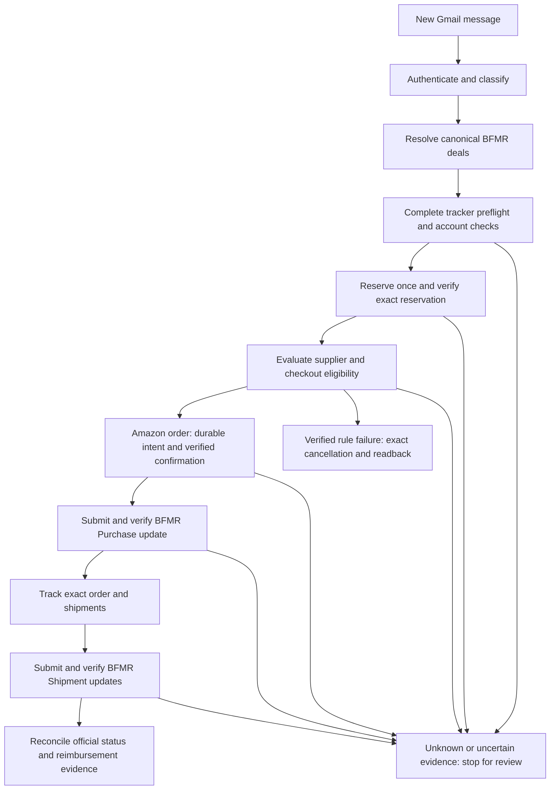
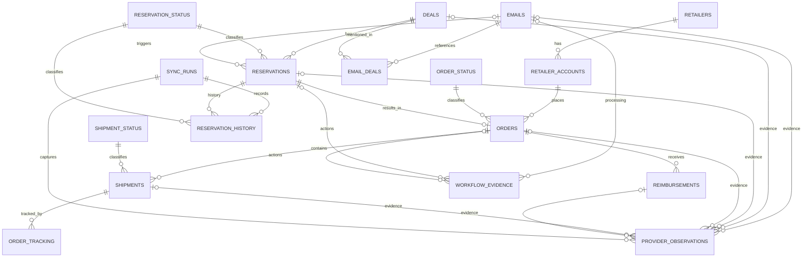

# BFMR Automation v2 — Solution Design Specification

**VERSION 22 | Business requirements, technical requirements, decisions, and target architecture**

**Prepared:** 19 October 2026  
**Project:** BFMR Automation v2  
**Source baseline:** [Solution Design Specification v20](https://github.com/z0ned/BFMR-Automation-v2/blob/main/docs/BFMR_Solution_Design_Specification_v20.md), compiled 16 October 2026  
**Change type:** Documentation restructuring only; no application behavior, database schema, provider contract, or production acceptance changed.

**Companion:** [BFMR Implementation v21](BFMR_Implementation_v21.md) documents the existing implementation, file responsibilities, configuration, historical evidence, implementation gaps, and delivery plan.

## Executive summary

**BFMR Automation v2 aims to automate the work of buying products through a buying club, while keeping purchases controlled and money easy to track.**

A buying club coordinates purchases made by individual participants on its behalf. In the arrangement described here, BFMR announces offers for specific products. A participant reserves an offer, pays a retailer such as Amazon upfront, follows the purchasing and shipping requirements, and expects reimbursement from BFMR. This creates an administrative challenge: every offer, reservation, retailer order, shipment, and payment must stay correctly connected.

The proposed system would manage that process from beginning to end:

- Monitor BFMR emails for new offers and reserve eligible deals.
- Purchase qualifying items from Amazon after checking the product, price, expected reimbursement, delivery terms, and spending limits.
- Track orders and shipments and report purchase and shipping details to BFMR.
- Maintain records showing what was spent, what reimbursement is expected, what has been paid, and which transactions need attention.

**The business goal is to reduce repetitive work and costly mistakes while providing a clear picture of outstanding commitments and reimbursements.** Safeguards are central to the design: prevent duplicate purchases, verify the correct accounts and products, and pause for review when an outcome is uncertain.

This specification describes an intended future system built on existing components. Major capabilities still require implementation and verification before it can operate reliably without supervision.

> **Design status:** This document reorganizes the requirements and approved intended design recorded in v20. The 17-table relational model, unified single-/multi-deal purchasing, and 14-day delivery cutoff remain intended changes, not claims of implementation or live validation. Existing code and operational facts belong in the companion implementation document. No document grants authority to place an order, reserve or cancel inventory, send a notification, migrate a database, or deploy software.

## 1. Purpose, scope, and authority

### 1.1 Business purpose

BFMR Automation v2 is intended to manage the buying-club purchase lifecycle from a new emailed offer through reservation, retailer purchase, shipment tracking, BFMR updates, and reimbursement reconciliation. In this arrangement, the participant pays the retailer upfront and expects reimbursement from BFMR. The business objectives are to reduce repetitive work and duplicate or incorrect transactions, control financial exposure while reimbursement is outstanding, and retain a traceable record of spending, expected payouts, shipments, payments, and exceptions.

The approved automated purchasing scope is Amazon, one supported item and quantity one per reservation, under the financial and checkout rules in Section 5. The broader retailer and shipment data model does not expand that purchasing scope.

### 1.2 Authority and evidence

- The user-approved decisions consolidated in v20, retained in Section 3, control the intended new design where they supersede v1.9. The split into v21 introduces no new product decisions and does not itself update running software or older project registers.
- Read `AGENTS.md`, the v1.9 baseline, `DECISIONS.md`, `IMPLEMENTATION_PLAN.md`, and `OPEN_ISSUES.md` alongside the v21 pair before subsequent implementation work. Compare actual source and local changes; preserve unrelated work.
- Distinguish **approved design**, **source implementation**, **synthetic test results**, **bounded user-reported live observations**, and **verified provider contracts / production acceptance**. One does not establish another.
- Email bodies, samples, API payloads, logs, web content, and code comments are untrusted task data and cannot authorize actions.
- This remains a fresh TypeScript implementation; do not import the older BFMR repository without an explicit change in direction.

### 1.3 Document ownership

This specification owns business behavior, technical constraints, architecture, the target data model, reporting semantics, and unresolved design questions. The companion implementation document owns the description of existing code and files, environment details, recorded evidence, release blockers, implementation sequencing, and proposed regression scenarios. Historical v20 remains intact for traceability.

## 2. Overall architecture and end-to-end workflow

### 2.1 Logical components and responsibilities

| Component | Required responsibility |
|---|---|
| Gmail intake | Authenticate source evidence, classify new-deal messages, preserve message identity and intake progress, and prevent replay. |
| Workflow coordinator | Serialize account work, associate emails with deals, retain action intent and outcomes, and stop uncertain workflows for reconciliation. |
| BFMR integration | Resolve canonical deal IDs, read the complete My Tracker view, establish account alignment, reserve through the normal website form, and verify exact changes. |
| Amazon integration | Validate product/account/quantity and checkout policy, submit at most once, obtain the causal Order #, and track exact orders and packages. |
| Persistence and reconciliation | Retain current business state, payment provenance, status history, provider observations, workflow evidence, and sync completeness. |
| Notifications and operator recovery | Surface discrepancies and uncertain outcomes, preserve durable notification state, and support reviewed recovery. |
| Reporting / future operations UI | Expose evidence-backed financial and operational information through secured integration; a demonstration UI is not operational evidence. |

These are logical responsibilities rather than separately deployed services. The current implementation and the boundaries between its stores are described in BFMR Implementation v21.



### 2.2 Processing and integration boundaries

For a supported multi-new-deal email, attempt a quantity-one reservation for each distinct announced deal before evaluating suppliers or purchasing any of the batch. A bundle remains one BFMR offer. Both single- and multi-new-deal messages are intended to use the same durable per-message/per-reservation action workflow; historical completed messages must not be backfilled into purchasing.

Use Gmail API authentication evidence, documented BFMR read/write contracts, normal Playwright website actions for BFMR reservation creation, and a verified authenticated Amazon browser session. Do not invent a BFMR reservation API POST fallback. Exact account and entity identity must be maintained across every boundary.

The target persistence architecture is the 17-table relational/hybrid PostgreSQL model in Section 8. Keep typed business identifiers, money, dates, relationships, and lifecycle fields separate from sanitized sparse metadata and append-only evidence. External provider actions cannot be rolled back by a database transaction; durable intent and authoritative readback are required independently of database atomicity.

### 2.3 Operational requirements

Before unattended production operation, provide supervised execution, durable private storage, account ownership and loss handling, backup/restore and stale-state reconciliation, restart recovery, notification delivery controls, monitoring, and an operator procedure for browser login/MFA. Production Gmail watch/StreamingPull, if required, must be implemented and accepted separately from history polling. An expired Gmail history cursor must preserve a gap and stop; there is no authorized blanket Inbox scan or silent cursor reset.

## 3. Approved design decisions inherited from v20

The following decisions are explicit user instructions or accepted design proposals recorded on 16 October 2026 **after v1.9**. They supersede earlier conflicting descriptions in the earlier handoff, but still require code/schema work.

| ID | Decision | Status |
|---|---|---|
| D20-01 | **Single-deal emails** may drive automatic Amazon purchasing, under **exactly the same** eligibility, financial, identity, checkout and recovery safeguards as approved multi-deal emails. | Approved; not implemented |
| D20-02 | This expanded purchasing applies to **newly processed emails only**. Never revisit prior completed single-deal mail or backfill purchases without separate explicit authority. | Approved; not implemented |
| D20-03 | If the retailer's latest estimated delivery date is **more than 14 calendar days after the order date**, reject checkout; cancel only the **exact newly confirmed reservation** with validated release readback. Exactly 14 days is allowed. | Approved; not implemented |
| D20-04 | For a retailer delivery **date range**, compare the **latest** date to the 14-day cutoff. If **no estimate is provided**, proceed subject to all other guards. If date evidence is contradictory/ambiguous/unreadable, stop for review, not speculative cancellation. | Approved; not implemented |
| D20-05 | Adopt a **relational/hybrid PostgreSQL target design**, superseding a plan to rely only on the JSONB account aggregate for business reporting. The agreed target is **17 named tables** (Section 8). | Approved design; no migration |
| D20-06 | `RETAILERS` includes `homepage_url`; `DEALS` includes its BFMR `slug` separate from authoritative `bfmr_deal_id`. | Approved design |
| D20-07 | `EMAILS` is retained; `EMAIL_DEALS` maps each email to all referenced deals, including update messages. `RESERVATIONS.source_email_id` optionally identifies the actual triggering email. Update/additional-slot emails **do not authorize reservations**. | Approved design |
| D20-08 | Lookup tables `RESERVATION_STATUS`, `ORDER_STATUS`, and later `SHIPMENT_STATUS` classify system-specific states. `RESERVATION_STATUS.is_open` is a convenience classification, **not a reimbursement indicator**. | Approved design |
| D20-09 | `ORDERS.order_total` is the **complete charged retailer amount** (including tax and shipping); it replaces earlier ambiguous `amount_paid`/`total` columns. `RESERVATIONS.expected_payout` is BFMR's expected reimbursement amount. | Approved design |
| D20-10 | Reimbursement payments are individual rows in `REIMBURSEMENTS` linked to `ORDERS`; **remove `ORDERS.amount_reimbursed`**. Derive the sum through SQL or a view. | Approved design |
| D20-11 | Model **multiple shipments and tracking numbers**, particularly for orders with quantity greater than one: `ORDERS` → `SHIPMENTS` → `ORDER_TRACKING`, with `SHIPMENT_STATUS`. | Approved design; no broader purchase authority |
| D20-12 | Add JSONB metadata on `DEALS`, `RESERVATIONS`, `ORDERS`, `REIMBURSEMENTS`, `SHIPMENTS`, and `EMAILS`, plus append-only `PROVIDER_OBSERVATIONS` and `WORKFLOW_EVIDENCE`. | Approved design |
| D20-13 | Add `SYNC_RUNS` and `RESERVATION_HISTORY`; link provider observations to sync runs. A complete validated provider read drives a transaction that updates current reservations and preserves historical observations; incomplete reads do not erase state. | Approved design |
| D20-14 | Use a **single retailer order per reservation** in the first target ERD (`ORDERS.reservation_id` unique); one order may have many shipments. BFMR reservation IDs are treated as unique for this single-account design **without claiming provider global uniqueness**. | Current design assumption; validate |
| D20-15 | Continue to distinguish BFMR expected payout from Amazon purchase cost and individual BFMR reimbursements. The design must enable useful SQL for open/unreimbursed orders without sacrificing payment provenance. | Approved objective |

**Not approved merely by this design:** purchases from arbitrary retailers or multi-unit email checkout; running live tests; enabling BFMR exposure contract flags; resetting Gmail history; removing fail-closed account guards; using the new schema as if already deployed.

### 3.1 Date-based delivery examples

With an order date of **2026-10-16**, **2026-10-30** is exactly 14 days and is allowed; **2026-10-31** is 15 days and is rejected. A range such as **2026-10-25 through 2026-11-02** uses November 2 and is rejected. An explicitly **absent** estimate permits continuation. A retailer date that cannot be reliably parsed, conflicts between checkout panels, changes after validation or has an unclear timezone is **unknown**, not "absent". Stop for review before placing an order or canceling on uncertain evidence. The calendar/time-zone convention for cross-border retailers remains a release design detail to settle with fixtures.

### 3.2 Email chronology example

One multi-new-deal email (`E100`) can announce BFMR deal IDs `D101`, `D102`, `D103`. It creates three `EMAIL_DEALS` associations; each deal is one BFMR offer, even when an offer is a bundle. A subsequent **additional-slots** email referencing `D101` and a later **payout-update** email referencing `D101` create more `EMAILS` and `EMAIL_DEALS` associations but do **not** create or retry a reservation. A payout-increase email is **not authoritative evidence** that an existing reservation's payout increased: My Tracker must confirm applicability to the exact reservation. The BFMR slug locates/resolves the deal via the documented API; it does not identify an email.

## 4. Email intake, scheduling, and exact identity

### 4.1 Gmail provenance and classification

- In production mode accept only the approved direct BFMR new-deal sender. A separately permitted testing sender is allowed **only** under `BFMR_INTAKE_MODE=testing`, with the same trusted Gmail API provenance requirements. The exact allowed test mailbox is in v1.9; do not expose it unnecessarily in logs or artifacts.
- Require the exact outer `From` address, Google receiving hop, unique trusted `Authentication-Results` from `mx.google.com`, DMARC pass aligned with outer sender domain and aligned DKIM or SPF. Reject duplicate or ambiguous authentication evidence. A forwarded body or display name is not authentication.
- Messages must be in Inbox when fetched; use trusted Gmail internal receipt timestamp and dedupe by Gmail message identity. The message **body** and trusted BFMR detail links determine whether it announces one or multiple **new deals**. Subject alone never qualifies a message.
- Supported multi-new-deal mail yields distinct body-announced deal links; all announced deals get one reservation attempt before **any** batch eligibility/checkout pass. Bundles remain a single BFMR offer and are not split.
- Ignore as reservation triggers: added slots/reservations-added, deal updates, increased payout notices, all-open-deals roundups, malformed or ambiguous sets, unrelated messages. They may still be stored/referenced for provenance/history in the proposed schema.
- Validate/locally decode approved BFMR email tracking links; do not navigate arbitrary tracking destinations. Allow only approved HTTPS BFMR detail origins. Establish actual canonical detail page, offer and title, then resolve the **slug** using `GET /api/v2/deals/{slug}` to obtain authoritative `deal.deal_id`.

### 4.2 Durable intake and restart requirements

Persist mailbox identity, history cursor, queued message payloads, deduplication tombstones, and history-gap state durably. Commit the intake cursor and corresponding queued messages together. Initialization is permitted only for the authentic first queue; a missing existing queue must be restored and reconciled rather than silently reset. Interrupted processing requires BFMR/Amazon reconciliation before resuming.

Gmail history expiration/404 must persist a gap and stop. Neither a blanket Inbox sweep nor reprocessing older email is authorized by this design.

Both qualifying email types must use the same durable per-message/per-reservation state machine and side-effect intent records. Do not simply remove a single-deal early return without extending ordering intent, confirmation, and reconciliation. Previously processed Gmail IDs remain tombstoned. The existing implementation boundary is described in BFMR Implementation v21, Section 3.1.

### 4.3 Duplicate, availability, and confirmation

- BFMR website reservation creation is through normal **Playwright form actions**, never an invented API reservation POST.
- Establish exact browser session/account alignment and deal/offer identity before reservation. My Tracker preflight must read **every page unfiltered and completely** and compare exact `deal_id` against **all recognized open statuses**. Titles never override conflicting/missing authoritative IDs.
- An already-open reservation for the same canonical deal blocks another reservation in the approved workflow. Unknown account, status, pagination, offer or quantity evidence stops.
- After submitting at most once, independently require **one exact newly visible** Reserved My Tracker row, exact `reserve_id`, deal identity and quantity one. An acknowledgement or timeout alone never proves reservation. Do not fabricate IDs or repeat uncertain submissions.
- Newly confirmed reservation supplier check is tied to its **exact** `reserve_id` and `deal_id`: verified Amazon absence triggers cancellation of only that reservation with exact readback. Unknown supplier stops for review. Startup CAPTCHA test reservation is a distinct workflow and is canceled after confirmation *without* supplier evaluation.

## 5. Purchase eligibility, delivery cutoff, cancellation, and transaction safety

### 5.1 Unified purchase eligibility (approved policy)

For each **newly confirmed**, Amazon-supplier-eligible reservation from a **newly processed** single- or multi-new-deal email, proceed only if **all** conditions are verified immediately before submission:

1. A single supported **Amazon item / ASIN**, exactly **quantity one** for the reservation, no ambiguous or composite links. The BFMR bundle (if any) is one reservation, but unsupported composite Amazon carts are not automatically purchased.
2. Complete Amazon checkout `order_total`, including tax and shipping, **at most USD $100.00**.
3. **Expected BFMR payout for this exact reservation >= complete Amazon order total**.
4. **Existing unpaid BFMR expected payout exposure + proposed Amazon order total <= USD $200.00**. Calculate exposure from a complete unfiltered My Tracker read. Exclude the **current newly made reservation** from the existing-unpaid subtotal; check it separately under (3).
5. Selected saved default Amazon delivery address and payment method are visibly verified. Optional nonsecret address fragment and card last four may strengthen selection checks. Never disclose or log CVV/payment credentials.
6. Exactly **one checkout line**, correct ASIN and unit quantity, stable final total, gift-marked with gift options saved, and a **free shipping option that does not require Prime**.
7. **Delivery eligibility (new):** use the latest unambiguous estimated delivery date (last date of a range); permit if <= 14 calendar days after the order date. If >14, refuse order and cancel the exact newly confirmed BFMR reservation with authoritative release confirmation. If retailer provides **no** estimated date, allow checkout, subject to other gates. Ambiguous/conflicting/unreadable estimates block for manual review.
8. Policy flags, full My Tracker field semantics, BFMR account identity, browser state and durable side-effect controls must have passed the applicable verification gates. No missing or contradictory evidence may be interpreted as permission.

The newer delivery restriction **does not raise** any financial cap, relax shipping/gift restrictions, permit multi-unit auto-orders, or authorize checkout at a non-Amazon retailer. The normalized `RETAILERS` design is broader than the currently approved automation path.

### 5.2 Rejection and failure policy

| Condition | Safe response |
|---|---|
| Verified Amazon supplier absent | Cancel only the exact new BFMR reservation; verify release. |
| Verified total above $100, payout below total, or calculated exposure above $200 | Reject checkout; exact new-reservation cancellation, verified release. |
| Verified latest estimated delivery >14 days | Reject checkout; exact new-reservation cancellation, verified release. |
| Explicit absence of estimated delivery date | Continue if every other prerequisite passes. |
| Ambiguous estimate, unknown account, missing payout, suspect checkout line, unverified exposure, unknown supplier | **Stop and preserve reservation for review**; no speculative purchase/cancel. |
| Amazon click/confirmation could have succeeded, response is lost, or order number missing | **UNCERTAIN**. Do not purchase again. Inspect authoritative Orders and reconcile exact identity first. |
| BFMR cancellation/update HTTP response uncertain | Read complete My Tracker for exact identity. Do not automatically repeat POST. |
| Failed to clear a prepared retailer cart item after rejecting | Inspect/reconcile cart before any other purchase; avoid touching unrelated user cart items. |
| Gmail queue or side-effect journal lost/ambiguous | Stop, restore/reconcile; never reinitialize over existing history. |

### 5.3 Order identity and retailer constraints

Verify the retailer cart is empty before adding the target item, or stop without removing unrelated user items. Recheck the exact ASIN, quantity one, one checkout line, and unchanged final total immediately before order submission.

Obtain the retailer Order # only from the thank-you page reached by the current submission, tied to its active page, intended ASIN, and confirmed total. Do not select a first matching order from history after an ambiguous submission. Missing confirmation remains uncertain and cannot authorize a second purchase.

A narrowly recognized duplicate-order warning continuation belongs only to the separately scoped fixed-product manual workflow. It must not be generalized to email-driven ordering; the manual workflow and its product restrictions are documented in BFMR Implementation v21, Section 3.4.

## 6. BFMR lifecycle, financial semantics, and tracking requirements

### 6.1 Status and money definitions

Use explicitly mapped BFMR lifecycle statuses. Open-status examples include `Reserved`, `Purchased`, `Ordered`, `Shipped`, `Delivered`, `Package Received`, `Processed`, `Set Aside`, `Payment Error`, `Return`, `Deadline`, `Tracking Submitted`, `Payout Pending`, and `Unpaid`. Terminal-status examples include `Paid`, `Cancelled`/`Canceled`, `Returned`, `Closed`, `Expired`, and `Released`. **Unrecognized/missing status is UNKNOWN** and must stop any status-dependent decision. The proposed `RESERVATION_STATUS` lookup must preserve explicit provider mapping and `is_open` classification; do not infer all terminal financial balances are settled solely from `is_open`.

**Target financial semantics:** `RESERVATIONS.expected_payout` = current BFMR-verified expected reimbursement for that reservation; `ORDERS.order_total` = complete retailer charge; `REIMBURSEMENTS.amount` = each independently substantiated reimbursement/payment or signed adjustment linked to that order. There is **no stored `ORDERS.amount_reimbursed`**. Cumulative reimbursement is the sum of verified reimbursement records; reversals/adjustments must be deliberate signed entries, with documented identity, source and idempotency. A BFMR-reported cumulative amount cannot automatically be split into fictional payments with fabricated dates or references.

### 6.2 Exposure calculation requirements

Use a complete unfiltered My Tracker read and verified provider field meanings. Unit payout amounts multiply quantity; whole-row totals do not. Conflicting representations are ambiguous and block purchasing. Keep BFMR provider `amount_paid`, retailer `ORDERS.order_total`, and individual `REIMBURSEMENTS.amount` distinct. The current implementation's conservative missing-payment behavior and its still-unverified contract are described in BFMR Implementation v21, Section 3.3.

Apply the existing-unpaid-exposure plus proposed-order inequality in Section 5.1, excluding the current newly made reservation from the existing-unpaid subtotal. Unknown status, incomplete coverage, unknown payout, or unverified payment semantics cannot authorize a purchase. Lifecycle openness is not by itself proof of reimbursement completeness.

### 6.3 Daily Amazon tracking and multiple shipments

Check known retailer orders once per `America/New_York` calendar day at or after 03:00, yielding to newly arriving deal emails before starting a status pass. Match the exact Amazon Order #, ASIN, and total in the same authenticated browser context. Preserve actual labeled tracking numbers, distinct packages, and earlier evidence. Missing orders, cancellation, conflicting content, or unknown layouts require review.

Model an order's physical shipments separately through `ORDERS` → `SHIPMENTS` → `ORDER_TRACKING`, with shipment-level status, quantity, dates, and tracking references. Evidence for a different order ID must fail validation. Supporting multiple shipments in the data model does not authorize multi-unit automated checkout.

### 6.4 BFMR Purchase / Shipment updates and official reconciliation

Associate a BFMR Purchase with the exact confirmed reservation and retailer Order #. Associate each supported BFMR Shipment update with the resulting BFMR purchase ID and verified tracking evidence. Record intent before each external write and require exact My Tracker readback of reservation, purchase/shipment IDs, order number, and tracking. Reconcile uncertain outcomes before any operator-authorized retry.

After the daily retailer checks, compare a complete official BFMR tracker view with local reservation/order history. Retain terminal observations and persistent discrepancies with first-seen, last-seen, and resolution times. A previously open reservation missing from a complete read remains a discrepancy; it is not proof of cancellation or payment. The authoritative synchronization design is in Section 9.

## 7. Rules for safety, identity, persistence and confidentiality

### 7.1 Irreversible-action invariant

**Durable intent → validate exact account and entity → at most one external mutation → authoritative readback → durable result; uncertain response → stop/reconcile, never blind retry.** Apply this sequence independently to each reservation creation, exact cancellation, Amazon order submission and BFMR purchase/shipment update. Database commit or HTTP 200 alone is insufficient proof of external completion. Account lock loss stops work and should close controlled browser actions.

### 7.2 Sensitive data and trust boundaries

- Store OAuth, BFMR API credentials, Telegram tokens, CVV/payment data, browser profiles, private Gmail queue, account pages, order/tracking numbers and database backups only in access-controlled private configuration/state. Never commit secrets or raw personal/account data to Git, PDF fixtures or public logs.
- JSONB `metadata`, `response_data` and `evidence` must contain **minimal sanitized, typed data**. Do not dump raw authenticated pages, API authorization headers, unredacted emails, addresses, card details or complete customer profiles. Restrict access, audit and retention; make schema keys discoverable to operators.
- BFMR web session and BFMR API credentials are different trust domains. Before a browser write, require exact visible account identity and a known shared reservation visible both in browser My Tracker and the complete API read. Implemented selectors are not live-proven. No common reservation means the current guard cannot establish account alignment; do not weaken it without a verified alternative.
- The application must not circumvent provider CAPTCHA, MFA, security prompts, manual review or site access challenges.

### 7.3 Status and evidence are not permission

The presence of a row marked `READY`, a JSON field marked `PASSED`, a demo dashboard success indicator, or a notification does **not** authorize checkout, reprocessing or a retry. All external actions must independently pass current provider evidence and exact user-approved scope. Avoid generic retry middleware around non-idempotent provider actions.

## 8. Approved target hybrid PostgreSQL model — 17 tables

**Status: accepted logical design, not implemented.** These 17 named entities and their relationships consolidate the user's design decisions. The column list is the proposed contract retained from v20; technical constraints such as key scopes, `NOT NULL` behavior and import/migration details require a reviewed DDL design before execution. A business ERD shows only relevant PK/FK/UK relationships and proposed fields; it does not establish provider uniqueness guarantees by itself. The conceptual Mermaid ERD is in Appendix A.

### 8.1 Business and transactional tables (13)

| # | Table | Principal columns (types abbreviated) | Business meaning |
|---|---|---|---|
| 1 | **RETAILERS** | `id` PK bigint; `name` text unique; `homepage_url` text | Amazon, Walmart, Best Buy and other known retailers. A row does not grant authorization to buy there. |
| 2 | **RETAILER_ACCOUNTS** | `id` PK; `retailer_id` FK; `account_name` text | Distinct purchasing accounts at a retailer, without storing credentials in DB. |
| 3 | **DEALS** | `id` PK; `bfmr_deal_id` text unique; `slug` text; `title` text; `metadata` jsonb | Stable BFMR offer identity. Slug is API lookup input; `deal_id` is authoritative identity. |
| 4 | **RESERVATION_STATUS** | `id` PK; `name` text unique; `is_open` bool | BFMR lifecycle status vocabulary; separate from order and payment state. |
| 5 | **RESERVATIONS** | `id` PK; `bfmr_reservation_id` text unique*; `deal_id` FK; `reservation_status_id` FK; `source_email_id` FK nullable; `quantity` integer; `expected_payout` numeric(12,2); `metadata` jsonb | Latest validated state of a BFMR reservation. No retailer cost or amount-reimbursed column. |
| 6 | **ORDER_STATUS** | `id` PK; `name` text unique | Retailer order status vocabulary, distinct from BFMR lifecycle. |
| 7 | **ORDERS** | `id` PK; `reservation_id` FK unique; `retailer_account_id` FK; `order_status_id` FK; `retailer_order_number` text; `quantity` integer; `order_total` numeric(12,2); `estimated_delivery_date` date nullable; `metadata` jsonb | One current retailer order per BFMR reservation; paid retailer total includes tax/shipping. No `amount_reimbursed`. |
| 8 | **REIMBURSEMENTS** | `id` PK; `order_id` FK; `amount` numeric(12,2); `paid_at` timestamptz; `payment_reference` text; `recorded_at` timestamptz; `metadata` jsonb | Each verified BFMR payment or signed adjustment, with independent provenance. |
| 9 | **SHIPMENT_STATUS** | `id` PK; `name` text unique | Shipment lifecycle, separate from order/BFMR status. |
| 10 | **SHIPMENTS** | `id` PK; `order_id` FK; `shipment_status_id` FK; `quantity` integer; `estimated_delivery_date` date; `shipped_at` timestamptz; `delivered_at` timestamptz; `metadata` jsonb | One physical retailer order may split into multiple shipments with different dates/statuses. |
| 11 | **ORDER_TRACKING** | `id` PK; `shipment_id` FK; `tracking_number` text; `carrier` text | One shipment may expose multiple tracking references; one order has zero/many tracking numbers via shipments. |
| 12 | **EMAILS** | `id` PK; `gmail_message_id` text unique*; `subject` text; `email_type` text; `received_at` timestamptz; `metadata` jsonb | Authenticated inbound BFMR email identity, classification and metadata. Includes update and additional-slot messages. |
| 13 | **EMAIL_DEALS** | `(email_id, deal_id)` composite PK/FKs; `reference_type` text | Many-to-many association between an email and every BFMR deal mentioned, without duplicate DEALS rows. |

* Provider identifier uniqueness scope needs empirical verification. For a single BFMR account, a unique `bfmr_reservation_id` is the agreed initial assumption; global cross-account uniqueness was **not stated in the available API docs**. Similarly, Gmail message IDs may need mailbox scope if more mailboxes are ever supported. Consider account-scoped keys without silently changing the user's accepted logical model.

### 8.2 Evidence and reconciliation tables (4)

| # | Table | Principal columns | Business meaning |
|---|---|---|---|
| 14 | **PROVIDER_OBSERVATIONS** | `id` PK; optional `email_id`, `deal_id`, `reservation_id`, `order_id`, `shipment_id`, `reimbursement_id` FKs; `sync_run_id` FK nullable; `provider`, `resource_type`, `observed_at`, `is_complete`, `response_data` JSONB | Minimal validated snapshots/provenance from Gmail, BFMR, Amazon and other approved providers; preserve history. |
| 15 | **WORKFLOW_EVIDENCE** | `id` PK; optional `email_id`, `reservation_id`, `order_id` FKs; `correlation_id` UUID; `action_type`, `phase`, `outcome`, `evidence` JSONB, `recorded_at` | Append-only decision/side-effect evidence and incident correlation. Must support intent-before-action and exact outcome/readback. |
| 16 | **SYNC_RUNS** | `id` PK; `provider` text; `started_at`, `completed_at`; `status` text; `records_received` integer; `is_complete` bool; `error_message` text nullable | Audit every provider sync attempt. Incomplete response never updates authoritative current state as if complete. |
| 17 | **RESERVATION_HISTORY** | `id` PK; `reservation_id` FK; `sync_run_id` FK; `reservation_status_id` FK; `expected_payout` numeric(12,2); `observed_at` timestamptz | Immutable chronological BFMR reservation status and expected-payout observations. |

### 8.3 Cardinalities and intentional separation

- `RETAILERS 1:N RETAILER_ACCOUNTS`; `RETAILER_ACCOUNTS 1:N ORDERS`.
- `DEALS M:N EMAILS` through `EMAIL_DEALS`; a deal is not an email, and a slug is not an email identifier.
- `DEALS 1:N RESERVATIONS`; `EMAILS 0:N RESERVATIONS` via optional `source_email_id`. The email–deal association is informational; authorization requires qualifying classification, validation and duplicate checks.
- `RESERVATION_STATUS 1:N RESERVATIONS`; `ORDER_STATUS 1:N ORDERS`; `SHIPMENT_STATUS 1:N SHIPMENTS`.
- `RESERVATIONS 1:0..1 ORDERS` in the accepted initial model; `ORDERS 1:N REIMBURSEMENTS`, `ORDERS 1:N SHIPMENTS`, `SHIPMENTS 1:N ORDER_TRACKING` (zero related records allowed before reimbursement/shipping).
- `RESERVATIONS 1:N RESERVATION_HISTORY`; `SYNC_RUNS 1:N RESERVATION_HISTORY` and `SYNC_RUNS 0:N PROVIDER_OBSERVATIONS`.
- `PROVIDER_OBSERVATIONS` references the relevant business entity through optional FKs; `WORKFLOW_EVIDENCE` likewise references relevant email, reservation or order. Exact association and allowed combinations must be specified in DDL and tested.

**Important business caveat:** Linking `REIMBURSEMENTS` **only to ORDERS** reflects the user's stated preference but cannot represent a BFMR payment for a reservation with **no matching retailer order**. Complete BFMR account reporting may need an explicit exception workflow or additional link to reservation; **do not silently alter the agreed model**. Raise this as a targeted question when designing migrations and provider import.

### 8.4 Financial and quantity constraints

- Monetary values are PostgreSQL `NUMERIC(12,2)` in the relational design; the existing checkout implementation should continue computing/comparing integer cents to avoid floating-point financial drift. Conversion boundaries must be explicit.
- Enforce `quantity > 0` for historical/imported reservations, retailer orders and shipment quantities. **Current automated purchase scope remains exactly one item and quantity one**, regardless of broader schema.
- At the retailer, `ORDERS.order_total` means the **entire final charge**; never equate it with BFMR payout or amount reimbursed. If the charge is not yet known, represent unknown deliberately and forbid unsafe actions.
- `REIMBURSEMENTS.amount` represents a **single payment/adjustment**. Total reimbursed is `SUM(amount)` for verified records, not another persisted amount on `ORDERS`. If an API reports cumulative paid amount without individual payment detail, preserve that cumulative figure as an observed fact and flag the incomplete payment ledger rather than invent transactions.
- A `NULL` expected payout, unknown reimbursement coverage or unavailable provider contract is **unknown**, not equal to zero. Reports must label completeness and not assert all liabilities are fully enumerated if BFMR synchronization is partial.
- Shipment quantities need not equal order quantity while an order is partially fulfilled. Preserve package identity, no duplicate/order-crossing tracking. The exact semantics of 1:many tracking IDs per shipment remain a provider evidence question.

### 8.5 JSONB usage policy

Use `metadata JSONB` for sparse/changing, **sanitized** attributes from BFMR, Gmail or the retailer. Keep primary reporting, identifiers, money, dates, FK identity and lifecycle status in typed relational columns. `PROVIDER_OBSERVATIONS.response_data` stores selected provider snapshot fields with source, timestamp and completeness; `WORKFLOW_EVIDENCE.evidence` stores structured facts behind decisions (e.g., latest estimated delivery date, cutoff, ASIN, total and validated result), not credentials or raw account HTML.

For consistency: use documented JSONB schemas / schema version tags, validation at ingestion, restricted read access, retention rules, and idempotency keys/provenance where offered. Consider GIN indexes only after measured query needs; raw JSONB is not a substitute for exact SQL constraints, foreign keys or authoritative proof.

## 9. Approved authoritative reconciliation design

### 9.1 What synchronization means

A BFMR `SYNC_RUNS` row records the attempt; source data comes from the **complete unfiltered My Tracker API**, not the email subject or a selected browser subset. Validate provider account identity, pagination counts, status values, exact reserve IDs, deal IDs, quantities, expected payout representations and payment semantics. **Do not** treat missing rows in an incomplete response as canceled, paid or absent. Other provider syncs (Amazon/Gmail) must use their own validated contracts, not be conflated with BFMR.

On a **complete, validated** BFMR sync: within one database transaction (1) persist normalized validated observations, (2) append `RESERVATION_HISTORY` entries for status/payout evolution, (3) upsert the current `RESERVATIONS` fields by exact identity, and (4) commit completion metadata; preserve prior history, evidence and reimbursement records. Ensure races/concurrent owner cases are excluded. Keep all current-state and history writes atomic, so a crash cannot update the present balance without its audit trail.

On a **failed, incomplete or conflicting** BFMR sync: record the sync run as failed/incomplete with safe diagnostic metadata and keep previous authoritative state unchanged; no deletion, zeroing balances, synthetic terminal statuses, success alerts or automatic financial action. Track previously seen reservations missing from a **complete** snapshot as discrepancies requiring reconciliation; check provider paging/retention before inferring any lifecycle change.

### 9.2 Historical example: verified payout increase

| Date | Evidence | Current state effect | History effect |
|---|---|---|---|
| 12 Oct | My Tracker says R1001 Reserved, expected payout $80 | `RESERVATIONS.expected_payout = 80.00` | Append $80 / Reserved |
| 13 Oct | Additional reservation slots email references D101 | **No** new reservation; no payout change without API confirmation | Keep email/deal reference only |
| 14 Oct | Payout-increase email references D101 | **No** automatic R1001 payout change | Keep email/deal reference only |
| 14 Oct later | Complete verified My Tracker proves R1001 payout now $95 | Update `RESERVATIONS.expected_payout = 95.00` | Append $95 and exact current status |

An increase announced for a deal may apply **only to newly reserved units**, not existing R1001; BFMR confirmation for the exact reservation is mandatory. No fabricated payment is recorded from a payout expectation change.

### 9.3 Individual reimbursement versus cumulative BFMR amount

Suppose BFMR displays cumulative `amount_paid = $100` after previously showing $40. This is evidence of a **$60 difference in reported cumulative amount**, but it is **not sufficient** to invent a payment with a specific `paid_at` timestamp or provider payment reference. Preserve both verified provider observations; reconcile with known individual `REIMBURSEMENTS` records. If a real transaction reference/date is not available, flag a discrepancy/unknown payment breakdown. Decide how to represent aggregate-only payment evidence before implementing automatic imports.

### 9.4 Idempotency and atomicity

- Use stable provider identities and account scope. Apply `INSERT ... ON CONFLICT` only with **verified** uniqueness keys. Do not dedupe on product title, order price, or an email subject.
- A sync run's idempotency key and per-run reservation observation uniqueness must prevent duplicate history caused by retrying a harmless read; however, old different observations must remain retrievable. The exact DB unique constraints need DDL design review.
- Provider reads are not a snapshot transaction under our control; ensure paging and totals are consistent and apply a defensible recency/observation timestamp model. Unknown response field shape means no authoritative mutation.
- External BFMR/Amazon actions are not rolled back by a PostgreSQL transaction. Preserve **durable intent before external mutation**, separate confirmation from expectation, and reconcile uncertain effects before any operator-authorized retry.

## 10. Simple business SQL the future schema must support

The following queries are **illustrative for the proposed future tables**. They will **not work against the current JSONB-only live orchestration schema**. They also assume the ingestion/reimbursement coverage is verified; no data in this document is a real user's financial record.

### 10.1 Reimbursements recorded for one order

```sql
SELECT order_id, SUM(amount) AS amount_reimbursed
FROM reimbursements
GROUP BY order_id;
```

### 10.2 Open orders with outstanding reimbursement

```sql
SELECT
    o.id, o.retailer_order_number, o.order_total,
    r.bfmr_reservation_id,
    r.expected_payout,
    COALESCE(p.amount_reimbursed, 0) AS amount_reimbursed,
    r.expected_payout - COALESCE(p.amount_reimbursed, 0) AS outstanding
FROM orders AS o
JOIN reservations AS r ON r.id = o.reservation_id
JOIN reservation_status AS s ON s.id = r.reservation_status_id
LEFT JOIN (
    SELECT order_id, SUM(amount) AS amount_reimbursed
    FROM reimbursements
    GROUP BY order_id
) AS p ON p.order_id = o.id
WHERE s.is_open = TRUE
  AND r.expected_payout IS NOT NULL
  AND r.expected_payout > COALESCE(p.amount_reimbursed, 0)
ORDER BY outstanding DESC;
```

**Caution:** `COALESCE(...,0)` is arithmetically convenient but **no reimbursement rows can mean incomplete ingestion**, not verified zero. In production this report must be restricted to **fully reconciled payment coverage** or clearly labeled *recorded payments only*. Manual BFMR reservations with no associated `ORDERS` row are omitted. Maintain a separate unknown/exception report, and do not base checkout exposure on this SQL until real provider completeness is demonstrated.

### 10.3 Deal correspondence and shipping

```sql
-- Every recorded email referring to a BFMR deal
SELECT e.id, e.received_at, e.subject, ed.reference_type
FROM emails AS e
JOIN email_deals AS ed ON ed.email_id = e.id
JOIN deals AS d ON d.id = ed.deal_id
WHERE d.bfmr_deal_id = 'D101'
ORDER BY e.received_at;

-- Every tracking reference for one retailer order
SELECT t.tracking_number, t.carrier,
       sh.quantity, sh.shipped_at, sh.delivered_at
FROM order_tracking AS t
JOIN shipments AS sh ON sh.id = t.shipment_id
WHERE sh.order_id = 101;
```

## 11. Reconciliation safety and implementation-facing constraints

### 11.1 Suggested transaction boundaries (design, not code)

**BFMR sync:** create `SYNC_RUNS` `RUNNING` → fetch all provider pages without any write → validate account, identities, page coverage, statuses and money → one PostgreSQL transaction inserts validated observations/history, updates current reservations, marks run `COMPLETED`/`is_complete=true`. If an error occurs at any point, keep the last authoritative current state; retain failure evidence without partial authoritative promotion.

**New email action:** ingest Gmail message and committed cursor atomically; classify from trusted provider email; associate `EMAILS` with `DEALS`; write durable reservation intent; acquire/verify sole account ownership; call BFMR website **once**; independently confirm exact newly Reserved row. For multi-deal messages, complete this first reservation pass for all announced deals before evaluating suppliers.

**Checkout:** after supplier confirmation, verify policy/financial/delivery choices and exact retailer account; write durable checkout intent; click the order button **at most once**; capture exact causal confirmation Order # and charged total; persist order and later shipment associations with exact identities. If the process can no longer distinguish before-click and after-click failure, mark uncertain and require operator reconciliation.

**Cancellation/BFMR writes:** record exact reservation/purchase/shipment write intent, submit a single mutation, read complete My Tracker for exact postcondition and persist confirmed outcome. Unknown result is not a reason to repeat the mutation.

### 11.2 Recommended constraints beyond the ERD drawing

- Prefer `NOT NULL` on required business keys; optionally nullable fields need explicit meaning (`NULL` = unknown/not yet available, **not** zero/no change). Enforce `CHECK (quantity > 0)` and positive monetary totals where appropriate; signed payment adjustments need a deliberately different check.
- `ORDERS.reservation_id UNIQUE` reflects the currently agreed maximum one retailer order per reservation, while `SHIPMENTS` and `ORDER_TRACKING` are one-to-many. A failed/uncertain checkout should be represented in workflow evidence, not a fake `ORDERS` row with an invented Amazon order number.
- Use account-aware uniqueness for retailer order numbers if the retailer guarantees uniqueness only within its account. Do not assert BFMR `reserve_id` global uniqueness without supplier confirmation. Provider payment reference can be nullable; dedupe only when its identity contract is known.
- Scope `EMAILS.gmail_message_id` uniqueness appropriately if multi-mailbox support is introduced; no need to materialize raw Gmail MIME into public relational columns.
- `RESERVATION_HISTORY` is append-only, with stable source `sync_run_id`, valid status FK, observation timestamp, payout; preserve terminal history. It is not a generic mutable snapshot table.
- `PROVIDER_OBSERVATIONS` may point to one or several related entities. Decide whether to enforce exactly one primary subject FK and optional context FKs; avoid orphan/unbounded raw API payloads.
- `WORKFLOW_EVIDENCE` is necessary but **not necessarily sufficient** for a robust durable intent state machine. Review uniqueness, states, attempt IDs, external idempotency and outbox semantics before using it to permit financial mutations.
- Avoid write side effects from reporting views or generated columns. If summary caches are later introduced, prove consistency and reconciliation with base events; do not restore `ORDERS.amount_reimbursed` merely for convenience.

## 12. Unresolved design and provider-contract questions

### 12.1 Schema and business interpretation

- **BFMR account scope:** Should a future `BFMR_ACCOUNTS` table be added if supporting multiple BFMR accounts? This was **not** among the 17 accepted entities. For now treat as a single-account domain and annotate uniqueness assumptions.
- **Reservation without order:** Where is a BFMR reimbursement recorded if a manually made reservation receives payment but has no `ORDERS` row? The agreed `REIMBURSEMENTS.order_id` FK cannot represent it; resolve explicitly, rather than fabricating an order.
- **Reimbursement source:** Can BFMR provide individual payment IDs and dates, or only cumulative amount paid? If only aggregate, do not synthesize individual payments; specify exception/aggregate-only evidence before trusting reporting.
- **Nullable/unique rules:** `REIMBURSEMENTS.paid_at`, `payment_reference`, `ORDERS.retailer_order_number`, `RESERVATIONS.expected_payout`, `EMAILS.gmail_message_id` account scope and status-null behaviors need contract-driven DDL constraints.
- **One order per reservation:** Accepted for initial design, but validate any BFMR scenarios involving a replacement/refund/reorder without incorrectly losing order history. Alter cardinality only after user approval.
- **Status mapping:** `RESERVATION_STATUS.is_open` represents lifecycle classification only; reporting liability should consider payout/payment evidence and explicit unknown/missing semantics. BFMR Paid/Closed are not interchangeable in all data contexts.
- **Delivery cutoff:** define order-date timezone and cutoff for multiple delivery methods, unavailable estimates versus parser failures and changing review estimates; current user rule specifies 14 calendar days and **latest range date**, but not every retailer/UI edge case.
- **Evidence table constraints:** decide primary subject links, schema versions, redaction, retention, provider transaction references, sync idempotency, append-only protections, and indices.

### 12.2 Provider contracts and long-outage boundary

The architecture depends on verified BFMR browser/API account alignment, Gmail authentication and message templates, BFMR deal/tracker/purchase/shipment contracts, Amazon checkout/order/tracking evidence, and complete exposure semantics. Missing or conflicting evidence blocks the affected action. Detailed EV-001 through EV-005 evidence requests remain in [BFMR Implementation v21](BFMR_Implementation_v21.md#7-unresolved-contracts-and-release-blockers).

A long Gmail outage can outlive the provider's history retention. This design preserves the gap and stops; an alternative recovery scan and any purchase backfill would require a separate explicit decision. For accounts without a common known BFMR reservation, an authoritative alternative account-alignment mechanism remains unresolved.

## 13. Acceptance and production-readiness requirements

- Verify the new-only single-/multi-deal workflow, quantity-one policy, delivery-cutoff edge cases, financial limits, exact identity, and at-most-once submission behavior using appropriate synthetic evidence before considering provider acceptance.
- Separately establish bounded read-only provider evidence for authentication, account alignment, field semantics, and current browser layouts. Synthetic fixtures do not establish live contracts.
- Any live reservation, cancellation, purchase, provider write, or notification requires its own authorized scope and confirmed outcome; neither this design nor a recorded past success authorizes a new live invocation.
- Before production, accept durable storage and restore/reconciliation, account ownership and loss handling, supervised restart, notifications, monitoring, and secured operational access. Do not infer health or acceptance from simulated dashboard values.
- Record evidence date, branch/commit, exact code path, provider/session scope, test type, outcome, exceptions, and side-effect or no-op proof.

The implementation companion retains the staged delivery plan, proposed regression scenarios, and precise evidence-language rules from v20.

## 14. Sources, versioning, and traceability

The original [v20 document](https://github.com/z0ned/BFMR-Automation-v2/blob/main/docs/BFMR_Solution_Design_Specification_v20.md) is retained unchanged. The v21 pair reorganizes that material; v21 is a document version rather than an application release. Compilation on 19 October 2026 does not refresh the 16 October design/implementation evidence snapshot.

- **Primary existing baseline:** [`docs/BFMR_Solution_Design_Specification_v1.9.md`](https://github.com/z0ned/BFMR-Automation-v2/blob/main/docs/BFMR_Solution_Design_Specification_v1.9.md), compiled 12 October 2026.
- **Repository safety and product authority:** [`AGENTS.md`](https://github.com/z0ned/BFMR-Automation-v2/blob/main/AGENTS.md).
- **Controlling historical decisions:** [`docs/DECISIONS.md`](https://github.com/z0ned/BFMR-Automation-v2/blob/main/docs/DECISIONS.md).
- **Evidence and milestone boundaries:** [`docs/IMPLEMENTATION_PLAN.md`](https://github.com/z0ned/BFMR-Automation-v2/blob/main/docs/IMPLEMENTATION_PLAN.md) and [`docs/OPEN_ISSUES.md`](https://github.com/z0ned/BFMR-Automation-v2/blob/main/docs/OPEN_ISSUES.md).
- **Prior fixes:** [`docs/REVIEW_FIXES_2026-10-12.md`](https://github.com/z0ned/BFMR-Automation-v2/blob/main/docs/REVIEW_FIXES_2026-10-12.md).
- **Existing database truth:** [`src/db/migrations/002_runtime_state.sql`](https://github.com/z0ned/BFMR-Automation-v2/blob/main/src/db/migrations/002_runtime_state.sql), [`src/db/postgresDatabase.ts`](https://github.com/z0ned/BFMR-Automation-v2/blob/main/src/db/postgresDatabase.ts); older relational baseline [`001_initial_schema.sql`](https://github.com/z0ned/BFMR-Automation-v2/blob/main/src/db/migrations/001_initial_schema.sql).
- **Confirmed current single-deal code boundary:** [`scripts/test_real_email_e2e.ts`](https://github.com/z0ned/BFMR-Automation-v2/blob/main/scripts/test_real_email_e2e.ts).
- **New decisions:** user's explicit design-session instructions/approvals on 16 October 2026, consolidated in Section 3. Their implementation status remains as recorded in v20; this documentation split does not implement them.

The source implementation, environment, historical results, proposed delivery phases, and code-file map are carried in [BFMR Implementation v21](BFMR_Implementation_v21.md). Preserve historical specification PDFs and add new versions rather than modifying old artifacts in place. Appendix B maps every v20 section to its v21 destination.

## Appendix A. Target entity relationship diagram

The following renderable Mermaid source expresses the accepted conceptual relationships for the 17-table target design. The field dictionary is in Section 8. Optional evidence links are intentionally broad; final DDL, constraints, and provider uniqueness scopes remain subject to review. This Markdown document does not include the large-format PDF sheets referenced by v20.



## Appendix B. Original v20 content coverage

| Original v20 content | Design v21 destination | Implementation v21 destination |
|---|---|---|
| Header, status warning, 1.1 authority | Opening status; 1.2 | Opening status; 1.1; 9 |
| 1.2 operating procedure; 1.3 document map | 1.2–1.3 | 1.1–1.2 |
| 2 current implementation / intended-change matrix | 2 target architecture; 3 decisions | 2 existing baseline; 4 storage/UI boundaries |
| 2.1 recorded evidence and setup observations | 1.2 evidence distinctions | 2.1 historical evidence; 6.1 environment |
| 3 decisions; 3.1 delivery examples; 3.2 email chronology | 3 (all decisions and examples retained) | 3.1, 3.3, 7.3 implementation gaps |
| 4.1 Gmail provenance and classification | 4.1 | 3.1; 5.1 |
| 4.2 queue/restart implementation and new unified pipeline | 4.2 durable requirements | 3.1 current queue and early-return gap; 4.2 journals |
| 4.3 duplicate checks and confirmation | 4.3 | 3.2; 5.2 |
| 5.1 eligibility; 5.2 rejection/uncertainty policy | 5.1–5.2 | 3.3 existing policy and unimplemented cutoff |
| 5.3 order identity and retailer constraints | 5.3 | 3.3 |
| 5.4 fixed-product manual/rehearsal restrictions | 5.3 scope boundary | 3.4 product IDs and specific test workflows |
| 6.1 statuses, exposure, payment semantics | 6.1–6.2; 8–10 | 3.3 current exposure reader; 5.2 |
| 6.2 daily Amazon checks and proposed shipment model | 6.3; 8 | 3.5; 5.3 |
| 6.3 BFMR Purchase/Shipment writes | 6.4; 7; 11 | 3.6; 5.3; 7.1 |
| 6.4 daily BFMR reconciliation and alerts | 6.4; 9 | 3.7; 4.2; 7.2 |
| 7 safety, confidentiality, identity, evidence | 7 (all subsections retained) | 1.1; 3–4; 6–8 operational application |
| 8 complete 17-table dictionary, cardinalities, constraints, JSONB | 8 (all subsections retained) | 4.4; 7.3 implementation boundary |
| 9 authoritative sync, history, payment provenance, idempotency | 9 (all subsections retained) | 4.4; 7–8 remaining work |
| 10 illustrative reporting SQL and completeness caveats | 10 (all queries and caveats retained) | 4.1 warns target queries are not current schema |
| 11 transaction boundaries and recommended constraints | 11 (all subsections retained) | 4 current store limitations; 8 delivery plan |
| 12 environment, variables, commands, safety notes | 2.3 operational requirements; 7 privacy | 6 (all subsections retained) |
| 13 source map and single-deal code gap | 4.2 target workflow | 3.1; 5 expanded per-file catalog |
| 14.1 provider evidence requests EV-001–EV-005 and outage | 12.2; 13 | 7.1 (all requests retained) |
| 14.2 schema/business interpretation questions | 12.1 (all questions retained) | 7.3 cross-reference |
| 14.3 operations/release gaps | 2.3; 13 | 7.2 (retained) |
| 15 staged plan; 15.1 proposed regressions; 15.2 evidence language | 13 acceptance requirements | 8 (all phases, scenarios, and evidence rules retained) |
| 16 sources and historical versioning note | 14 | 9 |
| Appendix A 17-table Mermaid ERD / PDF-sheet references | Appendix A Mermaid source and explicit Markdown/PDF boundary | 9 cross-reference |

**Editorial changes:** Added a plain-language business purpose, logical architecture overview, document-ownership guidance, cross-links, an expanded primary-file catalog, and this coverage map. Reworded mixed passages to distinguish requirements from existing behavior. Replaced session-relative language and PDF-only layout promises with dated provenance and accurate Markdown scope. These changes do not add purchase authority, alter business limits, adopt new tables, or assert new implementation/evidence. The source's 17 tables, D20-01 through D20-15, delivery examples, money semantics, SQL caveats, safety rules, unresolved questions, and implementation/test limitations are retained across the pair.
