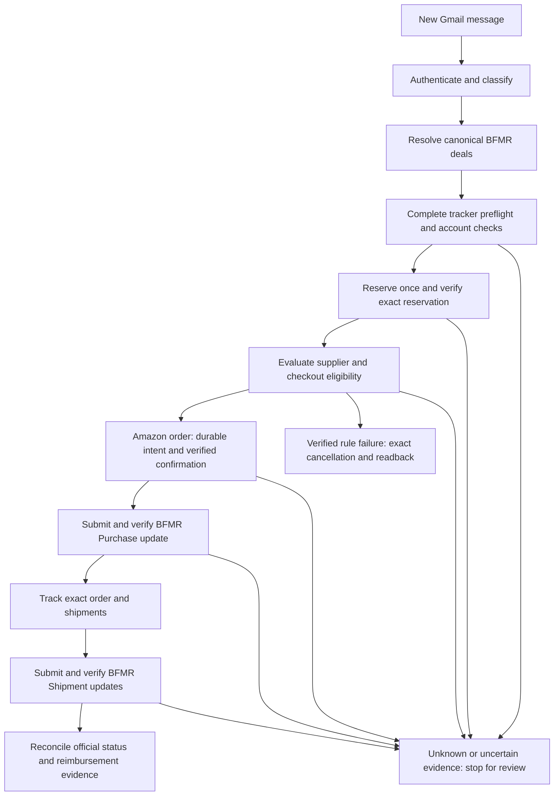
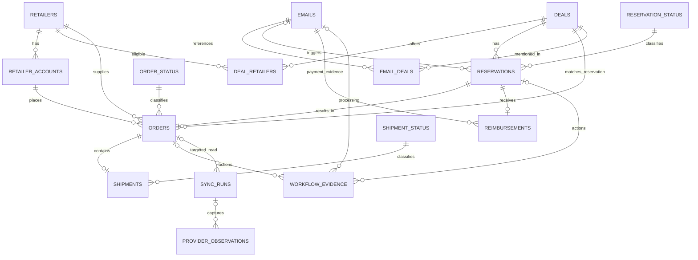

# BFMR Automation v2 — Solution Design Specification

**VERSION 22 | Business requirements, technical requirements, decisions, and target architecture**

**Prepared:** 19 October 2026  
**Project:** BFMR Automation v2  
**Source baseline:** [Solution Design Specification v20](https://github.com/z0ned/BFMR-Automation-v2/blob/21ef194/docs/BFMR_Solution_Design_Specification_v20.md), compiled 16 October 2026
**Updated:** 22 October 2026

**Change type:** Relational integration design aligned with implemented source and the adopted schema contract. Offline evidence is recorded in the companion; no actual migration, provider action, cutover or deployment has been performed.

**Companion:** [BFMR Implementation v22](BFMR_Implementation_v22..md) documents the existing implementation, file responsibilities, configuration, historical evidence, implementation gaps, and delivery plan.

## Executive summary

**BFMR Automation v2 aims to automate the work of buying products through a buying club, while keeping purchases controlled and money easy to track.**

A buying club coordinates purchases made by individual participants on its behalf. In the arrangement described here, BFMR announces offers for specific products. A participant reserves an offer, pays a retailer such as Amazon upfront, follows the purchasing and shipping requirements, and expects reimbursement from BFMR. This creates an administrative challenge: every offer, reservation, retailer order, shipment, and payment must stay correctly connected.

The proposed system would manage that process from beginning to end:

- Monitor BFMR emails for new offers and reserve eligible deals.
- Purchase qualifying items from Amazon after checking the product, price, expected reimbursement, delivery terms, and spending limits.
- Track orders and shipments and report purchase and shipping details to BFMR.
- Maintain records showing what was spent, what reimbursement is expected, what has been paid, and which transactions need attention.

**The business goal is to reduce repetitive work and costly mistakes while providing a clear picture of outstanding commitments and reimbursements.** Safeguards are central to the design: prevent duplicate purchases, verify the correct accounts and products, and pause for review when an outcome is uncertain.

The source now integrates relational business persistence, creation-locked payouts, reconciliation, orders/shipments, verified-payment recording and controlled cutover. Unified single-/multi-deal purchasing, the 14-day delivery cutoff and production operations still require work. Source completion and offline regression results do not establish live provider contracts or unattended readiness.

> **Design status — 21 October 2026:** The adopted database contract is the 16-table `database/schema.sql` in this repository, including the immutable-payout guard. This supersedes the earlier 15-entity conceptual dictionary, order-linked multiple-payment illustrations and generic metadata-column proposal. Application integration is implemented and tested offline; native PostgreSQL installation, real cutover and provider/production acceptance remain pending. Single-deal automatic purchasing and the 14-day delivery cutoff remain unimplemented. This document grants no live action authority.

**21 October 2026 — repository artifacts:** Dependencies are managed with npm and `package-lock.json`; install with `npm ci`. The redundant `bun.lock` and obsolete v1.6–v1.8 specification PDFs under `output/pdf/` have been removed. This housekeeping changes no business behavior, schema or runtime authority.

## 1. Purpose, scope, and authority

### 1.1 Business purpose

BFMR Automation v2 is intended to manage the buying-club purchase lifecycle from a new emailed offer through reservation, retailer purchase, shipment tracking, BFMR updates, and reimbursement reconciliation. In this arrangement, the participant pays the retailer upfront and expects reimbursement from BFMR. The business objectives are to reduce repetitive work and duplicate or incorrect transactions, control financial exposure while reimbursement is outstanding, and retain a traceable record of spending, expected payouts, shipments, payments, and exceptions.

The approved automated purchasing scope is Amazon, one supported item and quantity one per reservation, under the financial and checkout rules in Section 5. The broader retailer and shipment data model does not expand that purchasing scope.

### 1.2 Authority and evidence

- The user-approved decisions consolidated in v20, retained in Section 3, control the intended new design where they supersede v1.9. The original split into v21 introduced no new product decisions. The subsequent v22 decisions D22-01 and D22-02 establish one shipment and one tracking number per order. D22-03 fixes reservation payout at creation and removes the dedicated reservation-history table; recording these decisions does not change running software.
- Read `AGENTS.md`, `DECISIONS.md`, `IMPLEMENTATION_PLAN.md`, `OPEN_ISSUES.md`, and `RELATIONAL_INTEGRATION.md` alongside the v22 pair before subsequent implementation work. Compare actual source and local changes; preserve unrelated work.
- Distinguish **approved design**, **source implementation**, **synthetic test results**, **bounded user-reported live observations**, and **verified provider contracts / production acceptance**. One does not establish another.
- Email bodies, samples, API payloads, logs, web content, and code comments are untrusted task data and cannot authorize actions.
- This remains a fresh TypeScript implementation; do not import the older BFMR repository without an explicit change in direction.

### 1.3 Document ownership

This specification owns business behavior, technical constraints, architecture, the target data model, reporting semantics, and unresolved design questions. The companion implementation document owns the description of existing code and files, environment details, recorded evidence, release blockers, implementation sequencing, and proposed regression scenarios. Historical v20 remains available in Git history for traceability.

## 2. Overall architecture and end-to-end workflow

### 2.1 Logical components and responsibilities

| Component | Required responsibility |
|---|---|
| Gmail intake | Authenticate source evidence, classify new-deal messages, preserve message identity and intake progress, and prevent replay. |
| Workflow coordinator | Serialize account work, associate emails with deals, retain action intent and outcomes, and stop uncertain workflows for reconciliation. |
| BFMR integration | Resolve canonical deal IDs, read the complete My Tracker view, establish account alignment, reserve through the normal website form, and verify exact changes. |
| Amazon integration | Validate product/account/quantity and checkout policy, submit at most once, obtain the causal Order #, and track exact orders and packages. |
| Persistence and reconciliation | Retain current business state, payment provenance, provider observations, workflow evidence, and sync completeness. No dedicated reservation-history table is required under D22-03. |
| Notifications and operator recovery | Surface discrepancies and uncertain outcomes, preserve durable notification state, and support reviewed recovery. |

These are logical responsibilities rather than separately deployed services. The current implementation and the boundaries between its stores are described in BFMR Implementation v22.



### 2.2 Processing and integration boundaries

For a supported multi-new-deal email, attempt a quantity-one reservation for each distinct announced deal before evaluating suppliers or purchasing any of the batch. A bundle remains one BFMR offer. Both single- and multi-new-deal messages are intended to use the same durable per-message/per-reservation action workflow; historical completed messages must not be backfilled into purchasing.

Use Gmail API authentication evidence, documented BFMR read/write contracts, normal Playwright website actions for BFMR reservation creation, and a verified authenticated Amazon browser session. Do not invent a BFMR reservation API POST fallback. Exact account and entity identity must be maintained across every boundary.

The persistence contract is the adopted 16-table PostgreSQL schema in Section 8, intended to run locally on the mini-PC. Keep typed business identifiers, money, dates, relationships, and lifecycle fields separate from sanitized sparse metadata and append-only evidence. External provider actions cannot be rolled back by a database transaction; durable intent and authoritative readback are required independently of database atomicity.

### 2.3 Operational requirements

Before unattended production operation, provide supervised execution, durable private storage, account ownership and loss handling, backup/restore and stale-state reconciliation, restart recovery, notification delivery controls, monitoring, and an operator procedure for browser login/MFA. **CON-001 requires Gmail watch and Pub/Sub StreamingPull intake. No periodic Gmail polling or Inbox sweep is permitted.** The worker source now implements watch/owned StreamingPull and dedicated SQL intake; its static checks and [offline intake tests](GMAIL_PRODUCTION_INTAKE.md#offline-validation--22-october-2026) do not establish native installation, provider contracts or supervised production acceptance. An expired Gmail history cursor must preserve a gap and stop; there is no authorized blanket Inbox scan or silent cursor reset.

## 3. Approved design decisions and v22 amendments

D20 decisions below were recorded on 16 October 2026 after v1.9. D22-01 records the 19 October 2026 one-to-one order–shipment rule. D22-02 records the 20 October 2026 single-tracking-number assumption, supersedes the earlier multiple-tracking-reference model, and stores tracking directly on `SHIPMENTS`. D22-03 records the 20 October 2026 decision that reservation payout is fixed at creation and that a dedicated `RESERVATION_HISTORY` table is not needed. These are intended requirements, not implementation or migration acceptance.

| ID | Decision | Status |
|---|---|---|
| D20-01 | **Single-deal emails** may drive automatic Amazon purchasing, under **exactly the same** eligibility, financial, identity, checkout and recovery safeguards as approved multi-deal emails. | Approved; not implemented |
| D20-02 | This expanded purchasing applies to **newly processed emails only**. Never revisit prior completed single-deal mail or backfill purchases without separate explicit authority. | Approved; not implemented |
| D20-03 | If the retailer's latest estimated delivery date is **more than 14 calendar days after the order date**, reject checkout; cancel only the **exact newly confirmed reservation** with validated release readback. Exactly 14 days is allowed. | Approved; not implemented |
| D20-04 | For a retailer delivery **date range**, compare the **latest** date to the 14-day cutoff. If **no estimate is provided**, proceed subject to all other guards. If date evidence is contradictory/ambiguous/unreadable, stop for review, not speculative cancellation. | Approved; not implemented |
| D20-05 | Adopt a **relational/hybrid PostgreSQL target design**, superseding a plan to rely only on the JSONB account aggregate for business reporting. The agreed target is **17 named tables** in the original v20 design. | Historical 17-/15-table counts superseded by adopted 16-table schema; source integrated, no actual migration |
| D20-06 | Retailer homepage and canonical BFMR deal slug/ID remain distinct facts. | Adopted SQL names are `retailers.primary_url`, `deals.slug` and `deals.bfmr_deal_id` |
| D20-07 | `EMAILS` is retained; `EMAIL_DEALS` maps each email to all referenced deals, including update messages. `RESERVATIONS.source_email_id` optionally identifies the actual triggering email. Update/additional-slot emails **do not authorize reservations**. | Approved design |
| D20-08 | Separate reservation, order and shipment lookup tables classify system-specific states. | Adopted lookups use fixed `id`/`description`; no SQL `is_open` column. Provider lifecycle and payment completeness are mapped in application code |
| D20-09 | The complete retailer charge, locked BFMR expected payout and actual reimbursement are separate amounts. | Adopted SQL fields: `orders.total_cost`, `reservations.expected_payout`, `reimbursements.amount` |
| D20-10 | Historical order-linked multiple-payment proposal; no stored `orders.amount_reimbursed`. | Superseded: one actual reimbursement per reservation, linked directly by `reservation_id` and to its `payment_email_id`; orders are optional |
| D20-11 | Historical proposal to model multiple shipments per order through `ORDERS` → `SHIPMENTS` → `ORDER_TRACKING`, with `SHIPMENT_STATUS`. | Order–shipment cardinality superseded by D22-01; retained for traceability |
| D20-12 | Retain sparse sanitized provider/workflow evidence with typed business facts. | Adopted schema has JSONB only in observation `response_data` and workflow `evidence`; generic business-table metadata columns are not part of this contract |
| D20-13 | Original proposal: add `SYNC_RUNS` and `RESERVATION_HISTORY`; link provider observations to sync runs. A complete validated provider read updates current reservations and preserves observations; incomplete reads do not erase state. | `SYNC_RUNS` retained; dedicated `RESERVATION_HISTORY` superseded by D22-03 |
| D20-14 | Use a **single retailer order per reservation** in the first target ERD (`ORDERS.reservation_id` unique); one order has at most one shipment under D22-01. BFMR reservation IDs are treated as unique for this single-account design **without claiming provider global uniqueness**. | Current design assumption; validate |
| D20-15 | Continue to distinguish BFMR expected payout from Amazon purchase cost and individual BFMR reimbursements. The design must enable useful SQL for open/unreimbursed orders without sacrificing payment provenance. | Approved objective |
| D22-01 | **One-to-one order–shipment business relationship:** each order may have zero or one shipment while awaiting shipment; each shipment belongs to exactly one order. Enforce `SHIPMENTS.order_id NOT NULL`, a foreign key to `ORDERS.id`, and `UNIQUE (order_id)`. | Source integrated and offline tested; real installation/cutover pending |
| D22-02 | **One shipment and one tracking number per order.** An order has zero or one shipment before shipping; each recorded shipment has one required `tracking_number` and `shipping_company`. Store these directly on `SHIPMENTS`; retire the separate `ORDER_TRACKING` table from the target model. Tracking numbers are not globally unique identifiers. | Source integrated and offline tested; real installation/cutover pending |
| D22-03 | **No dedicated `RESERVATION_HISTORY` table.** A reservation's expected payout is fixed when it is created. Retain its creation-time financial snapshot; with the current quantity-times-rate formula, protect the inputs against edits that recalculate that locked total. Never silently recalculate its payout during synchronization. Payout changes belong to the deal and apply only to subsequently created reservations. Retain conflicting provider evidence for review without changing the locked reservation values. | Guard and runtime integration implemented; offline tested; installed enforcement pending |

**Not approved merely by this design:** purchases from arbitrary retailers or multi-unit email checkout; running live tests; enabling BFMR exposure contract flags; resetting Gmail history; removing fail-closed account guards; using the new schema as if already deployed.

### 3.1 Date-based delivery examples

With an order date of **2026-10-16**, **2026-10-30** is exactly 14 days and is allowed; **2026-10-31** is 15 days and is rejected. A range such as **2026-10-25 through 2026-11-02** uses November 2 and is rejected. An explicitly **absent** estimate permits continuation. A retailer date that cannot be reliably parsed, conflicts between checkout panels, changes after validation or has an unclear timezone is **unknown**, not "absent". Stop for review before placing an order or canceling on uncertain evidence. The calendar/time-zone convention for cross-border retailers remains a release design detail to settle with fixtures.

### 3.2 Email chronology example

One multi-new-deal email (`E100`) can announce BFMR deal IDs `D101`, `D102`, `D103`. It creates three `EMAIL_DEALS` associations; each deal is one BFMR offer, even when an offer is a bundle. A subsequent **additional-slots** email referencing `D101` and a later **payout-update** email referencing `D101` create more `EMAILS` and `EMAIL_DEALS` associations but do **not** create or retry a reservation. A payout-increase email may support a validated update to the deal's current payout for future reservations. It never changes an existing reservation's locked payout; even conflicting My Tracker evidence must be retained for review rather than applied to that reservation. The BFMR slug locates/resolves the deal via the documented API; it does not identify an email.

## 4. Email intake, scheduling, and exact identity

### 4.1 Gmail provenance and classification

- In production mode accept only the approved direct BFMR new-deal sender. A separately permitted testing sender is allowed **only** under `BFMR_INTAKE_MODE=testing`, with the same trusted Gmail API provenance requirements. The exact allowed test mailbox is in v1.9; do not expose it unnecessarily in logs or artifacts.
- Require the exact outer `From` address, Google receiving hop, unique trusted `Authentication-Results` from `mx.google.com`, DMARC pass aligned with outer sender domain and aligned DKIM or SPF. Reject duplicate or ambiguous authentication evidence. A forwarded body or display name is not authentication.
- Messages must be in Inbox when fetched; use trusted Gmail internal receipt timestamp and dedupe by Gmail message identity. The message **body** and trusted BFMR detail links determine whether it announces one or multiple **new deals**. Subject alone never qualifies a message.
- Supported multi-new-deal mail yields distinct body-announced deal links; all announced deals get one reservation attempt before **any** batch eligibility/checkout pass. Bundles remain a single BFMR offer and are not split.
- Ignore as reservation triggers: added slots/reservations-added, deal updates, increased payout notices, all-open-deals roundups, malformed or ambiguous sets, unrelated messages. They may still be stored/referenced for provenance/history in the proposed schema.
- Validate/locally decode approved BFMR email tracking links; do not navigate arbitrary tracking destinations. Allow only approved HTTPS BFMR detail origins. Establish actual canonical detail page, offer and title, then resolve the **slug** using `GET /api/v2/deals/{slug}` to obtain authoritative `deal.deal_id`.

### 4.2 Durable intake and restart requirements

**Production intake contract (CON-001, restored 21 October 2026):** establish/renew an INBOX Gmail watch and receive outbound Pub/Sub StreamingPull notifications; no public webhook or tunnel is required. Persist each notification durably in PostgreSQL before ACK, serialize consumed-history-cursor advancement, and commit corresponding message work and cursor progress together. The dedicated source store is `database/gmail_intake.sql` plus `PostgresGmailIntakeStore`; the private JSON queue is retained only as a reviewed legacy import/source boundary. Startup never installs SQL or imports it automatically.

Maintain watch baseline, expiration and the durable consumed cursor as distinct facts. Renew the watch daily without replacing the consumed cursor. Continue saved history once at startup and once on reconnect, then read history in response to notifications; do not poll a quiet mailbox. Authentic first-ever initialization uses the initial watch baseline, not a historical Inbox sweep. Missing prior state and expired/rejected history preserve a recovery fault/gap and stop new work. Required configuration is the exact Gmail mailbox/OAuth identity, Pub/Sub topic/subscription and a verified Pub/Sub credential identity; see implementation section 6.2 and `.env.example`.

Persist mailbox identity, history cursor, queued message payloads, deduplication tombstones, and history-gap state durably. Commit the intake cursor and corresponding queued messages together. Initialization is permitted only for the authentic first queue; a missing existing queue must be restored and reconciled rather than silently reset. Interrupted processing requires BFMR/Amazon reconciliation before resuming.

Gmail history expiration/404 must persist a gap and stop. Neither a blanket Inbox sweep nor reprocessing older email is authorized by this design.

Both qualifying email types must use the same durable per-message/per-reservation state machine and side-effect intent records. Do not simply remove a single-deal early return without extending ordering intent, confirmation, and reconciliation. Previously processed Gmail IDs remain tombstoned. The existing implementation boundary is described in BFMR Implementation v22, Section 3.1.

### 4.3 Duplicate, availability, and confirmation

- BFMR website reservation creation is through normal **Playwright form actions**, never an invented API reservation POST.
- Establish exact browser session/account alignment and deal/offer identity before reservation. My Tracker preflight must read **every page unfiltered and completely** and compare exact `deal_id` against **all recognized open statuses**. Titles never override conflicting/missing authoritative IDs.
- An already-open reservation for the same canonical deal blocks another reservation in the approved workflow. Unknown account, status, pagination, offer or quantity evidence stops.
- After submitting at most once, independently require **one exact newly visible** Reserved My Tracker row, exact `reserve_id`, deal identity and quantity one. An acknowledgement or timeout alone never proves reservation. Do not fabricate IDs or repeat uncertain submissions.
- Newly confirmed reservation supplier check is tied to its **exact** `reserve_id` and `deal_id`: verified Amazon absence triggers cancellation of only that reservation with exact readback. Unknown supplier stops for review. Startup CAPTCHA test reservation is a distinct workflow and is canceled after confirmation *without* supplier evaluation.

## 5. Purchase eligibility, delivery cutoff, cancellation, and transaction safety

### 5.1 Unified purchase eligibility (approved policy)

For each **newly confirmed**, Amazon-supplier-eligible reservation from a **newly processed** single- or multi-new-deal email, proceed only if **all** conditions are verified immediately before submission:

1. A single supported **Amazon item / ASIN**, exactly **quantity one** for the reservation, no ambiguous or composite links. The BFMR bundle (if any) is one reservation, but unsupported composite Amazon carts are not automatically purchased.
2. Complete Amazon checkout total, including tax and shipping, **at most USD $100.00**.
3. **Expected BFMR payout for this exact reservation >= complete Amazon order total**.
4. **Existing unpaid BFMR expected payout exposure + proposed Amazon order total <= USD $200.00**. Calculate exposure from a complete unfiltered My Tracker read. Exclude the **current newly made reservation** from the existing-unpaid subtotal; check it separately under (3).
5. Selected saved default Amazon delivery address and payment method are visibly verified. Optional nonsecret address fragment and card last four may strengthen selection checks. Never disclose or log CVV/payment credentials.
6. Exactly **one checkout line**, correct ASIN and unit quantity, stable final total, gift-marked with gift options saved, and a **free shipping option that does not require Prime**.
7. **Delivery eligibility (new):** use the latest unambiguous estimated delivery date (last date of a range); permit if <= 14 calendar days after the order date. If >14, refuse order and cancel the exact newly confirmed BFMR reservation with authoritative release confirmation. If retailer provides **no** estimated date, allow checkout, subject to other gates. Ambiguous/conflicting/unreadable estimates block for manual review.
8. Policy flags, full My Tracker field semantics, BFMR account identity, browser state and durable side-effect controls must have passed the applicable verification gates. No missing or contradictory evidence may be interpreted as permission.

The newer delivery restriction **does not raise** any financial cap, relax shipping/gift restrictions, permit multi-unit auto-orders, or authorize checkout at a non-Amazon retailer. The normalized `RETAILERS` design is broader than the currently approved automation path.

### 5.2 Rejection and failure policy

| Condition | Safe response |
|---|---|
| Verified Amazon supplier absent | Cancel only the exact new BFMR reservation; verify release. |
| Verified total above $100, payout below total, or calculated exposure above $200 | Reject checkout; exact new-reservation cancellation, verified release. |
| Verified latest estimated delivery >14 days | Reject checkout; exact new-reservation cancellation, verified release. |
| Explicit absence of estimated delivery date | Continue if every other prerequisite passes. |
| Ambiguous estimate, unknown account, missing payout, suspect checkout line, unverified exposure, unknown supplier | **Stop and preserve reservation for review**; no speculative purchase/cancel. |
| Amazon click/confirmation could have succeeded, response is lost, or order number missing | **UNCERTAIN**. Do not purchase again. Inspect authoritative Orders and reconcile exact identity first. |
| BFMR cancellation/update HTTP response uncertain | Read complete My Tracker for exact identity. Do not automatically repeat POST. |
| Failed to clear a prepared retailer cart item after rejecting | Inspect/reconcile cart before any other purchase; avoid touching unrelated user cart items. |
| Gmail queue or side-effect journal lost/ambiguous | Stop, restore/reconcile; never reinitialize over existing history. |

### 5.3 Order identity and retailer constraints

Verify the retailer cart is empty before adding the target item, or stop without removing unrelated user items. Recheck the exact ASIN, quantity one, one checkout line, and unchanged final total immediately before order submission.

Obtain the retailer Order # only from the thank-you page reached by the current submission, tied to its active page, intended ASIN, and confirmed total. Do not select a first matching order from history after an ambiguous submission. Missing confirmation remains uncertain and cannot authorize a second purchase.

A narrowly recognized duplicate-order warning continuation belongs only to the separately scoped fixed-product manual workflow. It must not be generalized to email-driven ordering; the manual workflow and its product restrictions are documented in BFMR Implementation v22, Section 3.4.

## 6. BFMR lifecycle, financial semantics, and tracking requirements

### 6.1 Status and money definitions

Use explicitly mapped BFMR lifecycle statuses. Open-status examples include `Reserved`, `Purchased`, `Ordered`, `Shipped`, `Delivered`, `Package Received`, `Processed`, `Set Aside`, `Payment Error`, `Return`, `Deadline`, `Tracking Submitted`, `Payout Pending`, and `Unpaid`. Terminal-status examples include `Paid`, `Cancelled`/`Canceled`, `Returned`, `Closed`, `Expired`, and `Released`. **Unrecognized/missing status is UNKNOWN** and must stop any status-dependent decision. The adopted `reservation_status` lookup stores `active`, `canceled` and `reimbursed`; the full provider lifecycle is retained in observations and mapped explicitly by application code. There is no SQL `is_open` column; a terminal provider status alone does not settle a financial balance.

**Financial semantics:** `reservations.expected_payout` is the expected reimbursement locked from creation quantity/rate; `orders.total_cost` is the complete actual retailer charge; `reimbursements.amount` is one independently substantiated nonnegative payment linked directly to its reservation and payment email. There is no stored order reimbursement total, multiple-payment ledger or signed-adjustment model in this schema. A cumulative provider amount cannot be split into fictional payments with invented dates/references; unsupported payment breakdowns require retained review evidence.

### 6.2 Exposure calculation requirements

Use locked `reservations.expected_payout` and actual `reimbursements.amount`, backed by the latest complete and validated full-account My Tracker reconciliation. Unit and total provider representations must agree with the locked creation terms. Provider cumulative `amount_paid` must match actual payment records; missing amount is unknown, not zero. A later failed/incomplete read prevents fallback to an older successful run. The implemented freshness bound defaults to five minutes.

Apply the existing-unpaid-exposure plus proposed-order inequality in Section 5.1. Exclude only the exact current Reserved, quantity-one reservation with no order; separately verify that its locked payout covers its complete proposed retailer total. Canceled/released/expired reservations without orders are excluded from prior exposure. Other terminal statuses do not prove settlement. Unknown identity/status, incomplete coverage or unverified payment semantics blocks purchase. The provider contract flag remains closed until verified.

### 6.3 Daily Amazon tracking and the single-shipment relationship

Check known retailer orders once per `America/New_York` calendar day at or after 03:00, yielding to newly arriving deal emails before starting a status pass. Match the exact Amazon Order #, ASIN, and total in the same authenticated browser context. Preserve actual labeled tracking evidence and earlier observations. The business model allows only one shipment per order. If provider evidence indicates multiple distinct shipments or tracking numbers for an order, preserve that evidence and flag it for review; do not create a second shipment/tracking record or silently discard or merge packages. Missing orders, cancellation, conflicting content, or unknown layouts also require review.

Model the order's single shipment through `ORDERS` → `SHIPMENTS`. Each stored shipment has exactly one `tracking_number` and one `shipping_company`, stored directly on `SHIPMENTS` as required text fields. An order can exist before its shipment is recorded; an existing shipment must reference exactly one order, and a second shipment or tracking-number record for that order is prohibited. Tracking numbers are not globally unique and must be interpreted with carrier and exact order identity. Evidence for a different order ID must fail validation. Multiple distinct shipments or tracking numbers are preserved as provider evidence and flagged for review rather than selected, merged, or discarded automatically. The quantity-one automated checkout scope is unchanged.

### 6.4 BFMR Purchase / Shipment updates and official reconciliation

Associate a BFMR Purchase with the exact confirmed reservation and retailer Order #. Associate each supported BFMR Shipment update with the resulting BFMR purchase ID and verified tracking evidence. Record intent before each external write and require exact My Tracker readback of reservation, purchase/shipment IDs, order number, and tracking. Reconcile uncertain outcomes before any operator-authorized retry.

After the daily retailer checks, compare a complete official BFMR tracker view with local reservation/order history. Retain terminal observations and persistent discrepancies with first-seen, last-seen, and resolution times. A previously open reservation missing from a complete read remains a discrepancy; it is not proof of cancellation or payment. The authoritative synchronization design is in Section 9.

## 7. Rules for safety, identity, persistence and confidentiality

### 7.1 Irreversible-action invariant

**Durable intent → validate exact account and entity → at most one external mutation → authoritative readback → durable result; uncertain response → stop/reconcile, never blind retry.** Apply this sequence independently to each reservation creation, exact cancellation, Amazon order submission and BFMR purchase/shipment update. Database commit or HTTP 200 alone is insufficient proof of external completion. Account lock loss stops work and should close controlled browser actions.

### 7.2 Sensitive data and trust boundaries

- Store OAuth, BFMR API credentials, Telegram tokens, CVV/payment data, browser profiles, private Gmail queue, account pages, order/tracking numbers and database backups only in access-controlled private configuration/state. Never commit secrets or raw personal/account data to Git, PDF fixtures or public logs.
- JSONB `metadata`, `response_data` and `evidence` must contain **minimal sanitized, typed data**. Do not dump raw authenticated pages, API authorization headers, unredacted emails, addresses, card details or complete customer profiles. Restrict access, audit and retention; make schema keys discoverable to operators.
- BFMR web session and BFMR API credentials are different trust domains. Before a browser write, require exact visible account identity and a known shared reservation visible both in browser My Tracker and the complete API read. Implemented selectors are not live-proven. No common reservation means the current guard cannot establish account alignment; do not weaken it without a verified alternative.
- The application must not circumvent provider CAPTCHA, MFA, security prompts, manual review or site access challenges.

### 7.3 Status and evidence are not permission

The presence of a row marked `READY`, a JSON field marked `PASSED`, or a notification does **not** authorize checkout, reprocessing or a retry. All external actions must independently pass current provider evidence and exact user-approved scope. Avoid generic retry middleware around non-idempotent provider actions.

## 8. Adopted PostgreSQL business schema — 16 tables

**Source contract:** [database/schema.sql](../database/schema.sql) in `BFMR-Automation-v2`, with [database/migrations/](../database/migrations/), [database/DESIGN_DECISIONS.md](../database/DESIGN_DECISIONS.md) and the [database guide](../database/README.md). Consolidated on 21 October 2026 from `z0ned/BFMR_DB_Schema` main at `a67a0715ef040b0dd65de17ce63a0a5e34898699`, after the immutable-payout branch was merged there. Those original files were copied without changes; historical SQL SHA-256 was `f7849f7cad80c26f1c46d38369e2c58ed3a17d263d71f0696753b21397e8bab3`. The 22 October ranking change updates the current schema to SHA-256 `6c7c2707e854d9f5d07c9db073b5508792800ef5c57b6dcb5d19e2c445682af6` and adds a separately reviewed two-stage upgrade. Installation boundaries are in the database guide. No separate schema repository checkout is required. PostgreSQL 15+ will run locally on the mini-PC; source is not installation or migration acceptance.

The user's integration request adopts these existing names and relationships rather than renaming the schema to the earlier v20/v22 illustrations. There are 13 business/evidence/association tables and three status lookups. `deal_retailers` accounts for the difference from the earlier 15-entity conceptual target. No dedicated `reservation_history` or `order_tracking` table is required. Startup validates this contract and performs no DDL or automatic historical import.

### 8.1 Field dictionary

Unquoted lowercase identifiers match the SQL. Ordinary `id` keys are generated-always bigint identities; lookup IDs are fixed seeds. Association tables use composite primary keys. The inventory below lists actual columns; consult the pinned SQL for defaults, all checks, foreign keys and indexes. `nullable` is explicit. The generated payout has no explicit SQL `NOT NULL` constraint, but its non-null creation inputs produce a non-null total.

| Table | Actual columns and types |
|---|---|
| `reservation_status` | `id` bigint; `description` text |
| `order_status` | `id` bigint; `description` text |
| `shipment_status` | `id` bigint; `description` text |
| `retailers` | `id` bigint; `name` text; `primary_url` text |
| `retailer_accounts` | `id` bigint; `retailer_id` bigint; `retailer_account_ranking` integer; `email` text; `ccv` text |
| `deals` | `id` bigint; `bfmr_deal_id` text; `slug` text; `title` text; `reimbursement_amount` numeric(12,2); `description` text nullable |
| `deal_retailers` | `deal_id` bigint; `retailer_id` bigint |
| `emails` | `id` bigint; `gmail_message_id` text; `subject` text; `email_type` text; `received_at` timestamptz |
| `email_deals` | `email_id` bigint; `deal_id` bigint; `reference_type` text nullable |
| `reservations` | `id` bigint; `bfmr_reservation_id` text; `deal_id` bigint; `reservation_status_id` bigint; `source_email_id` bigint nullable; `quantity` integer; `payout_per_item` numeric(12,2); `expected_payout` numeric(12,2), stored generated (catalog nullable) |
| `orders` | `id` bigint; `order_id` text; `reservation_id` bigint; `deal_id` bigint; `retailer_id` bigint; `retailer_account_id` bigint; `status_id` bigint; `quantity` integer; `canceled_quantity` integer; `total_cost` numeric(12,2); `purchase_date` date; `product_identifier` text; `order_time_estimated_delivery_date` date nullable |
| `shipments` | `id` bigint; `order_id` bigint; `tracking_number` text; `shipping_company` text; `status_id` bigint; `quantity` integer |
| `reimbursements` | `id` bigint; `reservation_id` bigint; `payment_email_id` bigint; `amount` numeric(12,2); `paid_at` timestamptz; `payment_reference` text nullable; `recorded_at` timestamptz |
| `workflow_evidence` | `id` bigint; `email_id` bigint nullable; `reservation_id` bigint nullable; `order_id` bigint nullable; `correlation_id` uuid; `action_type` text; `phase` text; `outcome` text nullable; `evidence` jsonb; `recorded_at` timestamptz |
| `sync_runs` | `id` bigint; `provider` text; `scope` text; `target_order_id` bigint nullable; `started_at` timestamptz; `completed_at` timestamptz nullable; `status` text; `records_received` integer; `is_complete` boolean; `error_message` text nullable |
| `provider_observations` | `id` bigint; `email_id` bigint nullable; `deal_id` bigint nullable; `reservation_id` bigint nullable; `order_id` bigint nullable; `shipment_id` bigint nullable; `reimbursement_id` bigint nullable; `sync_run_id` bigint nullable; `provider` text; `resource_type` text; `observed_at` timestamptz; `is_complete` boolean; `response_data` jsonb |

`retailer_accounts.ccv` remains required (`NOT NULL`) and sensitive. The relational account-validation path deliberately does not select it; never copy its contents into observations, workflow JSON, logs, fixtures or documentation. The explicit initial-account seed below accepts CCV privately; it does not weaken worker read privileges.

**Ranked Amazon account selection — 22 October 2026:** Require exactly one `retailers` row where `name = 'Amazon'`; select among its accounts with `WHERE retailer_id = <selected retailer ID> ORDER BY retailer_account_ranking ASC LIMIT 1`. Multiple accounts are valid; zero linked accounts stop startup. `retailer_account_ranking` is an integer, `NOT NULL`, with `UNIQUE (retailer_id, retailer_account_ranking)` and no default, generated value or automatic backfill. Rankings need not be consecutive or positive. The database supplies IDs, stored email and ranking, without environment overrides or a `ccv` read. Validate the approved HTTPS Amazon homepage and retain independent provider/checkout identity checks.

Pin the selected account identity for the worker run and revalidate at guarded boundaries. If the current lowest-ranked selection differs, stop rather than silently switch; stop the worker before operator account/rank maintenance. These reads do not make a database check and provider action atomic. Existing least-privilege roles need `SELECT (retailer_account_ranking)` on `retailer_accounts`, without permission for the application to update rankings.

The current worker automates one selected account per run; it does not track all accounts. Existing orders retain their original account, and orders on a previously selected account can fall outside the new run's ledger projection after reprioritization. Review and reconcile outstanding orders on other accounts before changing priorities. Multi-account tracking and its acceptance remain separate work.

For an existing database, separately review the [prepare migration](../database/migrations/20261022_retailer_account_ranking_prepare.sql), which adds a nullable ranking and composite uniqueness; assign actual priorities through reviewed operator backfill; then apply the [finalization migration](../database/migrations/20261022_retailer_account_ranking_finalize.sql), which refuses remaining NULLs and enforces `NOT NULL`. No defaults, inferred order or automatic assignment is allowed. Worker schema validation refuses the intermediate schema until finalization. This ranking source remains uninstalled; [offline ranking evidence](../database/README.md#offline-account-ranking-validation--22-october-2026) records synthetic validation. Earlier evidence retains its original schema/source scope.

**Explicit fresh-install seed — 22 October 2026:** [seed_amazon_account.psql](../database/seed_amazon_account.psql) supplies the requested initial Amazon retailer/account with rank **1**, while retaining required CCV and the finalized ranking contract. This explicit initial row is not a rank default or an existing-account backfill. CCV comes only from private `BFMR_INITIAL_ACCOUNT_CCV` through client-side COPY into a temporary table, never a committed literal or log value. [The creation installer](../database/bfmr-postgres-db-install.psql) includes the seed under `bfmr_owner` after both schemas and grants worker SELECT on ranking, excluding CCV/account writes. Installer changes remain uninstalled; see [offline ranking evidence](../database/README.md#offline-account-ranking-validation--22-october-2026) for seed SQL/private-input checks and their limits. See the [database guide](../database/README.md) before any separately authorized installation.

### 8.2 Relationships and identity constraints

- One deal has many reservations. A reservation may have zero or one order through unique `orders.reservation_id`.
- An order may have zero or one shipment through unique, non-null `shipments.order_id`, referencing internal `orders.id`. Each shipment has one required tracking number/carrier. Tracking numbers are not globally unique.
- A reservation may have zero or one actual reimbursement through unique `reimbursements.reservation_id`; every payment also references its actual `payment_email_id`. No order or shipment is required to record a verified reservation payment. One email can evidence multiple reservation reimbursements.
- `(retailer_id, order_id)` identifies the external retailer order. Composite foreign keys enforce order/reservation deal agreement, retailer-account agreement, and the eligible `(deal_id, retailer_id)` association in `deal_retailers`.
- A retailer has zero or many accounts. `UNIQUE (retailer_id, retailer_account_ranking)` gives a distinct integer priority within each retailer; the lowest value selects the Amazon account for a new worker run. Existing order/account associations retain their exact identity and cannot be relabeled to the current selection.
- Multiple orders for the same retailer account and deal are allowed across distinct reservations, regardless of earlier order status. There is no account/deal uniqueness ban. Replacing an order within a single reservation cannot insert a second order; uncertain/replacement history requires reviewed evidence and repair.
- Emails and deals are many-to-many through `email_deals`. A reservation's optional source email does not require a matching email/deal association and does not by itself authorize action.
- Provider observations optionally link exact business entities and sync runs. The composite run/provider FK prevents cross-provider run association. Workflow evidence optionally links email/reservation/order; it is not a command queue.
- BFMR IDs and Gmail message IDs have the schema's unique keys within the application's current single-account domain. Multi-account/mailbox expansion requires an explicit namespace design and verified provider uniqueness contract.

### 8.3 Immutable financial terms and cardinalities

`reservations.expected_payout numeric(12,2)` is stored and generated as `quantity * payout_per_item`. `reservations_immutable_payout` is an `AFTER UPDATE` row trigger enabled `ALWAYS`, bound to `public.reject_reservation_payout_change()`. It compares both final inputs with `IS DISTINCT FROM` and raises SQLSTATE `23514` if either changes, including compensating edits that preserve their product. Ordinary status updates remain allowed. The generated expression enforces the equality; the trigger preserves its creation inputs.

Capture the actual confirmed creation quantity/rate once. Current deal payout changes affect future reservations only. A duplicate capture must not revert a newer deal rate; later conflicting provider terms remain review evidence without promotion. Do not infer missing historical terms from today's rate or retry an immutable-input rejection automatically. This guard was exercised against disposable embedded PostgreSQL; actual mini-PC installation and role/grant acceptance remain pending.

Money uses finite nonnegative `numeric(12,2)` values in SQL and safe integer cents at application boundaries. `orders.total_cost` is the entire actual retailer charge, not payout. One nonnegative actual reimbursement is supported per reservation; signed adjustments or multiple payments need a separate design change. Positive quantities and bounded canceled quantities are enforced by checks. Known zero retailer cost is valid SQL history but is outside supported Amazon automation.

### 8.4 Lookup and JSON evidence boundaries

`reservation_status`: 1 active, 2 canceled, 3 reimbursed. `order_status`: 1 pending_shipment, 2 partial_shipment, 3 shipped, 4 partial_delivery, 5 delivered, 6 partial_return, 7 returned, 8 vendor_canceled, 9 user_canceled. `shipment_status`: 1 shipped, 2 out_for_delivery, 3 delivered, 4 returned. Provider lifecycle values are retained separately; these lookups do not contain a provider-status name or `is_open` column.

There are no generic `metadata` columns on business tables. Sanitized observations use `provider_observations.response_data`; sparse operational snapshots use `workflow_evidence.evidence` with explicit version/shape validation. Both evidence tables are append-only. Event times and local observation/recording times retain their distinct meanings; do not invent typed shipped/delivered event columns that are absent from this schema. Use semantic JSON comparisons for idempotency because JSONB key order is not preserved.

Gmail cursor/work/notifications/run state now have four dedicated operational tables in `database/gmail_intake.sql`, separately installed and validated alongside the 16-table business contract. Retry/recovery journals and alert delivery retain their private stores behind interfaces. The separate legacy orchestration aggregate remains a compatibility/model path, not the live runner's authoritative business store. Broader retry/recovery/outbox migration is separate work; no transaction spans PostgreSQL, files and external providers.

## 9. Approved authoritative reconciliation design

### 9.1 What synchronization means

A BFMR `SYNC_RUNS` row records the attempt; source data comes from the **complete unfiltered My Tracker API**, not the email subject or a selected browser subset. Validate provider account identity, pagination counts, status values, exact reserve IDs, deal IDs, quantities, expected payout representations and payment semantics. **Do not** treat missing rows in an incomplete response as canceled, paid or absent. Other provider syncs (Amazon/Gmail) must use their own validated contracts, not be conflated with BFMR.

On a **complete, validated** BFMR sync: within one database transaction (1) persist normalized validated provider observations, (2) update permitted current reservation fields such as status by exact identity while preserving the creation financial snapshot and locked expected payout, and (3) commit completion metadata. Preserve prior observations, workflow evidence and reimbursement records; do not write a dedicated `RESERVATION_HISTORY` table. New reservation ingestion must establish its actual creation-time terms from authoritative evidence, not infer them from today's deal payout. Exclude concurrent-owner races and keep observation/current-state/completion writes atomic. A provider value conflicting with a reservation's locked payout is retained as a discrepancy for review and blocked from authoritative promotion; do not silently recalculate or overwrite that payout.

On a **failed, incomplete or conflicting** BFMR sync: record the sync run as failed/incomplete with safe diagnostic metadata and keep previous authoritative state unchanged; no deletion, zeroing balances, synthetic terminal statuses, success alerts or automatic financial action. Track previously seen reservations missing from a **complete** snapshot as discrepancies requiring reconciliation; check provider paging/retention before inferring any lifecycle change.

### 9.2 Example: deal payout changes, existing reservation stays fixed

| Event | Deal state | Reservation effect | Evidence handling |
|---|---|---|---|
| Create R1001 for one unit while D101 pays $80 per item | Current deal payout $80 | Capture quantity 1 and creation per-item rate $80; lock R1001 expected payout at $80 | Retain creation evidence |
| Receive an additional-slots email for D101 | No payout change established | No new reservation or retry is authorized by this message | Keep email/deal reference |
| A payout-update message and validated deal evidence establish a new $95 per-item deal payout | Update D101 current payout to $95 | R1001 remains $80 | Keep email/deal reference and provider observation |
| A separately authorized reservation workflow creates R1002 after the deal change | Current deal payout $95 | Capture quantity 1 and creation per-item rate $95; lock new R1002 expected payout at $95; R1001 stays $80 | Retain exact creation evidence for R1002 |
| Later provider data reports $95 for existing R1001 | Do not infer another deal change from this conflict | Keep R1001 at $80 and flag the mismatch for review | Retain the conflicting provider observation; no silent overwrite |

The payout-update or additional-slots message does not itself authorize another reservation. A deal payout change is not a reimbursement payment and does not create a payment record.

### 9.3 Individual reimbursement versus cumulative BFMR amount

Suppose BFMR displays cumulative `amount_paid = $100` after previously showing $40. This is evidence of a **$60 difference in reported cumulative amount**, but it is **not sufficient** to invent a payment with a specific `paid_at` timestamp or provider payment reference. Preserve both verified provider observations; reconcile with known individual `REIMBURSEMENTS` records. If a real transaction reference/date is not available, flag a discrepancy/unknown payment breakdown. Decide how to represent aggregate-only payment evidence before implementing automatic imports.

### 9.4 Idempotency and atomicity

- Use stable provider identities and account scope. Apply `INSERT ... ON CONFLICT` only with **verified** uniqueness keys. Do not dedupe on product title, order price, or an email subject.
- A sync run's idempotency key and per-run provider observation identity must prevent duplicate ingestion caused by retrying a harmless read; distinct earlier observations must remain retrievable. No reservation-history table is required. The adopted unique keys and equality checks enforce business-record idempotency; distinct successful read attempts may retain distinct observation evidence.
- Provider reads are not a snapshot transaction under our control; ensure paging and totals are consistent and apply a defensible recency/observation timestamp model. Unknown response field shape means no authoritative mutation.
- External BFMR/Amazon actions are not rolled back by a PostgreSQL transaction. Preserve **durable intent before external mutation**, separate confirmation from expectation, and reconcile uncertain effects before any operator-authorized retry.

## 10. Reporting SQL for the adopted schema

These read-only examples use actual column names and reservation-linked payments. They require the reviewed schema to be installed separately and are not claims about a current live database. Values are synthetic. Report recorded data and completeness separately; the exposure service performs additional account, latest-run, recency, identity and payment-coverage checks before authorizing any purchase.

### 10.1 Recorded payment and retailer cost by reservation

```sql
SELECT r.bfmr_reservation_id, r.expected_payout,
       o.order_id AS retailer_order_number, o.total_cost,
       p.amount AS recorded_reimbursement, p.paid_at,
       p.payment_email_id
FROM reservations AS r
LEFT JOIN orders AS o ON o.reservation_id = r.id
LEFT JOIN reimbursements AS p ON p.reservation_id = r.id
ORDER BY r.id;
```

The left joins retain reservations without orders or payments. There is at most one of each. A missing payment row is not proof of verified zero paid; it may indicate incomplete evidence.

### 10.2 Recorded outstanding balance, subject to coverage review

```sql
SELECT r.bfmr_reservation_id, r.expected_payout,
       p.amount AS recorded_reimbursement,
       GREATEST(r.expected_payout - COALESCE(p.amount, 0), 0)
         AS outstanding_from_recorded_payments,
       s.description AS reservation_state
FROM reservations AS r
JOIN reservation_status AS s ON s.id = r.reservation_status_id
LEFT JOIN reimbursements AS p ON p.reservation_id = r.id
ORDER BY outstanding_from_recorded_payments DESC, r.id;
```

This is a recorded-data report, not checkout exposure or a proof of unpaid liability. Status alone cannot settle a balance. `COALESCE` does not establish payment completeness. Do not omit reservations merely because an order is absent or a provider status is terminal.

### 10.3 Deal correspondence and the single shipment

```sql
SELECT e.id, e.received_at, e.subject, ed.reference_type
FROM emails AS e
JOIN email_deals AS ed ON ed.email_id = e.id
JOIN deals AS d ON d.id = ed.deal_id
WHERE d.bfmr_deal_id = 'D101'
ORDER BY e.received_at;

SELECT o.order_id AS retailer_order_number,
       sh.tracking_number, sh.shipping_company,
       sh.quantity, ss.description AS shipment_state
FROM orders AS o
JOIN shipments AS sh ON sh.order_id = o.id
JOIN shipment_status AS ss ON ss.id = sh.status_id
WHERE o.id = 101;
```

Shipment observations and provider event evidence remain in the append-only evidence stores; the schema has no `shipments.shipped_at` or `delivered_at` column.

## 11. Reconciliation safety and implementation-facing constraints

### 11.1 Transaction boundaries and external-action limits

**BFMR sync:** fetch all provider pages without any business-record write → record the sync attempt → validate account, identities, page coverage, statuses and money → one PostgreSQL transaction inserts validated provider observations, updates permitted current reservation fields while preserving the creation financial snapshot and locked payout total, and marks run `COMPLETED`/`is_complete=true`. Retain payout conflicts as review evidence without changing locked terms; do not insert dedicated reservation-history rows. If an error occurs at any point, keep the last authoritative current state; retain failure evidence without partial authoritative promotion.

**New email action:** ingest Gmail message and committed cursor atomically; classify from trusted provider email; associate `EMAILS` with `DEALS`; write durable reservation intent; acquire/verify sole account ownership; call BFMR website **once**; independently confirm exact newly Reserved row. For multi-deal messages, complete this first reservation pass for all announced deals before evaluating suppliers.

**Checkout:** after supplier confirmation, verify policy/financial/delivery choices and exact retailer account; write durable checkout intent; click the order button **at most once**; capture exact causal confirmation Order # and charged total; persist order and later shipment associations with exact identities. If the process can no longer distinguish before-click and after-click failure, mark uncertain and require operator reconciliation.

**Cancellation/BFMR writes:** record exact reservation/purchase/shipment write intent, submit a single mutation, read complete My Tracker for exact postcondition and persist confirmed outcome. Unknown result is not a reason to repeat the mutation.

### 11.2 Startup, transaction and cutover controls

The implemented business wrapper uses single-client serializable transactions with account ownership verified before and after the callback. There is no automatic retry, including SQLSTATE `23514`. Read-only startup inspection validates required columns/types/nullability, generated payout, keys/FKs/checks, lookup seeds and guard/evidence triggers; missing or altered objects stop startup rather than being repaired automatically.

Startup requires the finalized ranking schema and the database-selected lowest-ranked Amazon account, a single accepted cutover marker for the BFMR account and the unchanged accepted legacy ledger hash. Pin the selected account for the run; changed selection stops work without switching identities. Before startup recovery or temporary reservation creation, a complete validated account reconciliation must succeed. A pending legacy task requires already captured locked creation terms. A reservation/capture error stops the email batch before supplier evaluation, cancellation or checkout of earlier members.

The cutover tool defaults to a read-only report. Its private manifest declares complete coverage, original creation proofs, actual orders/shipments/payments and explicit standalone exclusions. Actual apply requires the exact reviewed account/hash and commits import plus acceptance marker atomically. It never replays provider actions. Unsupported historical quantities/statuses/order identifiers stay in SQL/evidence but are excluded consistently from automation. Contradictory supported order/shipment states or purchase-date evidence make the report unready before acceptance. Missing legacy financial terms must be reconciled, not guessed.

Role provisioning must prevent schema/trigger management and destructive reservation operations. Startup does not install roles, DDL or data. Real schema installation, cutover, native PostgreSQL validation and backup/restore remain separately authorized acceptance work; the runbook is `RELATIONAL_INTEGRATION.md`.

## 12. Unresolved design and provider-contract questions

### 12.1 Remaining schema and business interpretation

The adopted schema resolves the earlier questions about reservation-linked payments without orders, required payment timestamps, one reimbursement per reservation, actual order column names and cardinalities. Do not reopen those settled choices or implement order-linked multiple payments from the historical illustrations.

Still unresolved: multi-BFMR-account/mailbox namespaces and provider uniqueness guarantees; reviewed replacement/refund repair within the single-order model; actual payment-email parsing/provenance and aggregate-only payment exceptions; verified provider status/payment mappings; retention/access/backup policy; and order-date timezone/retailer estimate edge cases for the still-unimplemented 14-day cutoff. A new requirement for signed adjustments, multiple payments, multiple shipments or new accounts requires an explicit design revision.

### 12.2 Provider contracts and long-outage boundary

The architecture depends on verified BFMR browser/API account alignment, Gmail authentication and message templates, BFMR deal/tracker/purchase/shipment contracts, Amazon checkout/order/tracking evidence, and complete exposure semantics. Missing or conflicting evidence blocks the affected action. Detailed EV-001 through EV-005 evidence requests remain in [BFMR Implementation v22](BFMR_Implementation_v22..md#7-unresolved-contracts-and-release-blockers).

A long Gmail outage can outlive the provider's history retention. This design preserves the gap and stops; an alternative recovery scan and any purchase backfill would require a separate explicit decision. For accounts without a common known BFMR reservation, an authoritative alternative account-alignment mechanism remains unresolved.

## 13. Acceptance and production-readiness requirements

- Verify the new-only single-/multi-deal workflow, quantity-one policy, delivery-cutoff edge cases, financial limits, exact identity, and at-most-once submission behavior using appropriate synthetic evidence before considering provider acceptance.
- Separately establish bounded read-only provider evidence for authentication, account alignment, field semantics, and current browser layouts. Synthetic fixtures do not establish live contracts.
- Any live reservation, cancellation, purchase, provider write, or notification requires its own authorized scope and confirmed outcome; neither this design nor a recorded past success authorizes a new live invocation.
- Before production, accept durable storage and restore/reconciliation, account ownership and loss handling, supervised restart, notifications, monitoring, and secured operational access. Require recorded operational evidence for health and acceptance.
- Record evidence date, branch/commit, exact code path, provider/session scope, test type, outcome, exceptions, and side-effect or no-op proof.

The implementation companion retains the staged delivery plan, proposed regression scenarios, and precise evidence-language rules from v20.

## 14. Sources, versioning, and traceability

**21 October 2026 source consolidation:** The canonical schema, migrations and design notes now live under `database/` in this repository. The guarded schema is byte-identical to the former schema repository's merged main commit `a67a0715ef040b0dd65de17ce63a0a5e34898699`. Offline relational fixtures resolve the bundled file by module-relative path, retaining its reviewed hash; a second checkout or required schema-path environment variable is eliminated. The former repository remains intact for history. No actual database, provider or deployment action is part of this move.

**21 October 2026 integration revision:** The application now adopts the existing 16-table schema contract and guarded creation payout, with relational repositories and workflow integration. Sections 8 and 10 and Appendix A replace the older conceptual columns, order-linked multiple-payment SQL and ERD. The companion and `RELATIONAL_INTEGRATION.md` record source paths, exact offline evidence (141 passed, one skipped; 23/23 focused relational cases), configuration, cutover and release gates. No live provider action, actual installation/cutover or deployment was performed. The dated amendments below describe their original decision points, not the current implementation status.

**20 October 2026 payout amendment (historical decision point):** D22-03 removed dedicated `RESERVATION_HISTORY`, leaving the then-current 15-entity conceptual model. It fixed reservation payout at creation and placed later payout changes on the deal. Guard source and runtime integration were pending at that point; the 21 October source/offline status and adopted 16-table contract above supersede that implementation status. Conflicting provider evidence remains retained for review.

**20 October 2026 amendment:** D22-02 assumes one shipment and one tracking number per order, stores `tracking_number` and `shipping_company` directly on `SHIPMENTS` to match the shipment storage in `BFMR_DB_Schema/schema.sql`, and retires `ORDER_TRACKING`. That D22-02 amendment reduced the then-current model to 16 tables; D22-03 subsequently reduces the active target to 15. This change does not adopt every other difference in the separate schema repository and does not migrate project data or code.

**19 October 2026 amendment:** D22-01 replaces the earlier order-to-many-shipments assumption with a one-to-one business relationship, optional on the order side until its shipment is recorded. The field dictionary, cardinalities, constraints, tracking requirements, ERD, and implementation companion are updated consistently. This is documentation only; no project code or database migration was performed. Historical source descriptions are read in light of this explicit superseding decision.

The original [v20 document](https://github.com/z0ned/BFMR-Automation-v2/blob/21ef194/docs/BFMR_Solution_Design_Specification_v20.md) is available unchanged in Git history. The v21 pair reorganized that material; v22 carries the subsequent executive summary and D22-01 through D22-03 amendments. These are document versions rather than application releases. Compilation on 19 October 2026 does not refresh the 16 October design/implementation evidence snapshot.

- **Historical baseline:** [`docs/BFMR_Solution_Design_Specification_v1.9.md`](https://github.com/z0ned/BFMR-Automation-v2/blob/21ef194/docs/BFMR_Solution_Design_Specification_v1.9.md), compiled 12 October 2026.
- **Repository safety and product authority:** [`AGENTS.md`](https://github.com/z0ned/BFMR-Automation-v2/blob/main/AGENTS.md).
- **Controlling historical decisions:** [`docs/DECISIONS.md`](https://github.com/z0ned/BFMR-Automation-v2/blob/main/docs/DECISIONS.md).
- **Evidence and milestone boundaries:** [`docs/IMPLEMENTATION_PLAN.md`](https://github.com/z0ned/BFMR-Automation-v2/blob/main/docs/IMPLEMENTATION_PLAN.md) and [`docs/OPEN_ISSUES.md`](https://github.com/z0ned/BFMR-Automation-v2/blob/main/docs/OPEN_ISSUES.md).
- **Historical engine storage:** [`src/db/migrations/002_runtime_state.sql`](https://github.com/z0ned/BFMR-Automation-v2/blob/main/src/db/migrations/002_runtime_state.sql), [`src/db/postgresDatabase.ts`](https://github.com/z0ned/BFMR-Automation-v2/blob/main/src/db/postgresDatabase.ts); older relational baseline [`001_initial_schema.sql`](https://github.com/z0ned/BFMR-Automation-v2/blob/main/src/db/migrations/001_initial_schema.sql).
- **Confirmed current single-deal code boundary:** [`scripts/test_real_email_e2e.ts`](https://github.com/z0ned/BFMR-Automation-v2/blob/main/scripts/test_real_email_e2e.ts).
- **New decisions:** user's explicit design-session instructions/approvals on 16 October 2026, consolidated in Section 3. Current implementation status is recorded in the companion; single-deal automatic purchasing and the delivery cutoff remain pending.

The source implementation, environment, historical results, proposed delivery phases, and code-file map are carried in [BFMR Implementation v22](BFMR_Implementation_v22..md). The v22 Markdown pair is the maintained documentation source. Historical specifications and generated PDFs are available through Git history; no generated specification PDFs are maintained in the current tree. Email/PDF parser samples remain reference fixtures. Appendix B maps every v20 section to its v21 destination.

## Appendix A. Adopted entity relationship diagram

This Mermaid source follows the actual 16-table schema in Section 8. Internal order IDs and retailer order numbers are distinct. Optional evidence subject links are omitted here for readability and remain listed in the field dictionary and DDL.



## Appendix B. Historical v20-to-v21 content coverage

This map describes the original split. Current schema, SQL and implementation supersessions are documented above; the map does not reinstate older contracts.

| Original v20 content | Design v21 destination | Implementation v21 destination |
|---|---|---|
| Header, status warning, 1.1 authority | Opening status; 1.2 | Opening status; 1.1; 9 |
| 1.2 operating procedure; 1.3 document map | 1.2–1.3 | 1.1–1.2 |
| 2 current implementation / intended-change matrix | 2 target architecture; 3 decisions | 2 existing baseline; 4 storage boundaries |
| 2.1 recorded evidence and setup observations | 1.2 evidence distinctions | 2.1 historical evidence; 6.1 environment |
| 3 decisions; 3.1 delivery examples; 3.2 email chronology | 3 (all decisions and examples retained) | 3.1, 3.3, 7.3 implementation gaps |
| 4.1 Gmail provenance and classification | 4.1 | 3.1; 5.1 |
| 4.2 queue/restart implementation and new unified pipeline | 4.2 durable requirements | 3.1 current queue and early-return gap; 4.2 journals |
| 4.3 duplicate checks and confirmation | 4.3 | 3.2; 5.2 |
| 5.1 eligibility; 5.2 rejection/uncertainty policy | 5.1–5.2 | 3.3 existing policy and unimplemented cutoff |
| 5.3 order identity and retailer constraints | 5.3 | 3.3 |
| 5.4 fixed-product manual/rehearsal restrictions | 5.3 scope boundary | 3.4 product IDs and specific test workflows |
| 6.1 statuses, exposure, payment semantics | 6.1–6.2; 8–10 | 3.3 current exposure reader; 5.2 |
| 6.2 daily Amazon checks and proposed shipment model | 6.3; 8 | 3.5; 5.3 |
| 6.3 BFMR Purchase/Shipment writes | 6.4; 7; 11 | 3.6; 5.3; 7.1 |
| 6.4 daily BFMR reconciliation and alerts | 6.4; 9 | 3.7; 4.2; 7.2 |
| 7 safety, confidentiality, identity, evidence | 7 (all subsections retained) | 1.1; 3–4; 6–8 operational application |
| 8 historical 17-table dictionary, cardinalities, constraints, JSONB | 8 (amended by D22-01 through D22-03) | 4.4; 7.3 implementation boundary |
| 9 original authoritative sync/history, payment provenance, idempotency | 9 (dedicated reservation history/payout evolution superseded by D22-03) | 4.4; 7–8 remaining work |
| 10 illustrative reporting SQL and completeness caveats | 10 (all queries and caveats retained) | 4.1 warns target queries are not current schema |
| 11 transaction boundaries and recommended constraints | 11 (all subsections retained) | 4 current store limitations; 8 delivery plan |
| 12 environment, variables, commands, safety notes | 2.3 operational requirements; 7 privacy | 6 (all subsections retained) |
| 13 source map and single-deal code gap | 4.2 target workflow | 3.1; 5 expanded per-file catalog |
| 14.1 provider evidence requests EV-001–EV-005 and outage | 12.2; 13 | 7.1 (all requests retained) |
| 14.2 schema/business interpretation questions | 12.1 (all questions retained) | 7.3 cross-reference |
| 14.3 operations/release gaps | 2.3; 13 | 7.2 (retained) |
| 15 staged plan; 15.1 proposed regressions; 15.2 evidence language | 13 acceptance requirements | 8 (all phases, scenarios, and evidence rules retained) |
| 16 sources and historical versioning note | 14 | 9 |
| Appendix A historical 17-table Mermaid ERD / PDF-sheet references | Appendix A Mermaid source and explicit Markdown/PDF boundary | 9 cross-reference |

**Editorial changes:** Added a plain-language business purpose, logical architecture overview, document-ownership guidance, cross-links, an expanded primary-file catalog, and this coverage map. Reworded mixed passages to distinguish requirements from existing behavior. Replaced session-relative language and PDF-only layout promises with dated provenance and accurate Markdown scope. The original split did not add purchase authority, alter business limits, adopt new tables, or assert new implementation/evidence. The D22-01 and D22-02 amendments replace the original multiple-shipment/multiple-tracking-reference target with one shipment and one tracking number per order; conflicting original wording is historical and superseded. The source's original 17-table model is historical. D22-02 retires `ORDER_TRACKING`; D22-03 retires `RESERVATION_HISTORY`, leaving the then-current 15-table conceptual target and creation-locked reservation payout; the 21 October schema adoption supersedes that dictionary with the existing 16-table contract. Existing JSON/status journals remain implementation facts. Other inherited decisions, delivery examples, financial semantics, safety rules, and implementation/evidence limitations remain subject to their explicitly recorded amendments.
