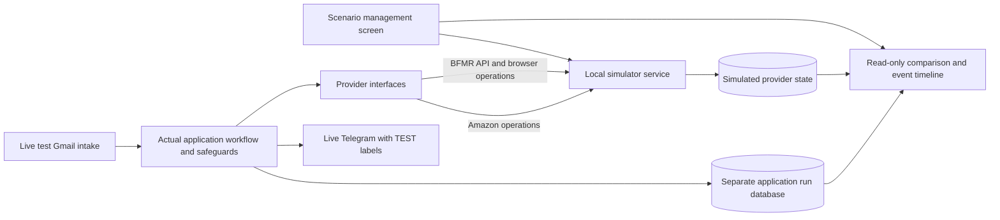

# Provider interface and scenario simulator — review proposal

**Status: APPROVED FOR PHASE 1 IMPLEMENTATION (Reservations, provider bundle, scenario UI).**  
**Prepared:** 23 October 2026  
**Updated:** 24 October 2026 — operator approved Phase 1; provider interface bundle (`src/providers/`) and mode gating implemented.<br>
**Source review baseline:** repository revision `3218a34`.  
**Scope of this change:** Provider interfaces and live bundle integration implemented in `src/providers/`, `src/services/bfmrWorker.ts`, and `src/services/dealEmailWorkflow.ts`. Remaining Phase 1 simulator engine and web UI in progress.

## 1. What this will let you do

Select a scenario on a screen, run the actual BFMR application workflow against
simulated BFMR and Amazon services, and inspect what happened. The simulator
stores its own version of deals, reservations, orders, shipments and payments
in PostgreSQL. It returns BFMR-shaped responses and models the effects of browser
actions. The application continues recording its own business/recovery state
independently, so we can test whether those records agree with the provider.

Example: create a scenario where reserving a deal succeeds at BFMR but the browser
never receives confirmation. The application must stop and reconcile. The screen
shows the simulated reservation that actually exists, the application's uncertain
state, and its test-labelled Telegram alert. Restarting must not reserve again.

The simulator is a repeatable provider model, not proof that a real website or
API behaves exactly the same way. Real-provider contract checks remain separate.

## 2. Requirements confirmed by the operator

| Decision | Requested behavior |
| --- | --- |
| Delivery order | **Reservations → purchases → tracking → cancellations → payments → insurance.** |
| BFMR | Simulate API calls **and browser actions**. |
| Amazon | Avoid live Amazon completely in simulation. Simulate checkout/orders/tracking. |
| Gmail | Live Gmail is allowed. Retain authenticated intake and durable processing. |
| Telegram | Live Telegram is allowed. Test messages must clearly identify themselves. |
| Scenario management | Provide a screen for creating/selecting/running scenarios. |
| Initial data | No preference specified. Recommend synthetic data first. |
| Current authorization | Produce this design for review; make no code changes yet. |

“Testing” currently supports live providers with separate credentials. This
proposal uses `BFMR_PROVIDER_MODE=simulation` as an explicit **simulation profile**
within the test environment;
it must not silently turn an existing live test setup into a simulator, or allow
a simulator run to fall back to live BFMR/Amazon.

### Environment and provider selection

The operator has added `BFMR_PROVIDER_MODE` to their private `.env` file. This
setting is now the named selector in this proposal. Adding the variable alone
does not implement provider switching: the current application has not been
changed to read or act on it as part of this documentation update.

One codebase serves both environments. Two independent settings select its
configuration and provider implementations at startup:

| Setting | Proposed values | Responsibility |
| --- | --- | --- |
| `BFMR_INTAKE_MODE` | `production`, `testing` | Existing environment/database/private-state selection and Gmail provenance rules. Existing unset-to-production behavior is unchanged by this proposal. |
| `BFMR_PROVIDER_MODE` | `live`, `simulation` | Select the complete BFMR/Amazon provider bundle within that environment. It does not select a database or change Gmail sender authentication. |

Proposed combinations:

| Intake mode | Provider mode | BFMR API/browser | Amazon | Gmail | Telegram | Startup |
| --- | --- | --- | --- | --- | --- | --- |
| `production` | `live` | Live | Live | Live production intake | Live production notifications | Allowed subject to existing production gates. |
| `production` | `simulation` | None started | None started | None started | None started | Reject before creating providers or starting intake. |
| `testing` | `live` | Live test-account configuration | Live test-account configuration | Live dedicated test intake | Live, labelled TEST | Preserve existing live-test capability and all identity/financial/recovery gates. This is **not** a simulation run. |
| `testing` | `simulation` | Simulated | Simulated | Live dedicated test intake | Live, labelled TEST with simulated-provider context | Use a validated, pinned scenario/run and isolated application/provider stores. |

**Proposed validation:** `BFMR_PROVIDER_MODE` is explicit and case-sensitive;
missing, blank or unrecognized values stop startup before provider construction,
intake or external actions. There is no implicit fallback to `live`. This is a
future implementation requirement for review, not a claim about current runtime
behavior. Both provider modes remain subject to all applicable environment gates.

Example configuration for the proposed simulation run:

```dotenv
BFMR_INTAKE_MODE=testing
BFMR_PROVIDER_MODE=simulation
```

Example production configuration:

```dotenv
BFMR_INTAKE_MODE=production
BFMR_PROVIDER_MODE=live
```

`BFMR_PROVIDER_MODE` is an unsuffixed control setting in the selected private
configuration file, not a credential with a `_TEST` or `_PRODUCTION` suffix.
On the installed Ubuntu host, use `/etc/bfmr/testing.env` and
`/etc/bfmr/production.env` respectively. Existing explicit `BFMR_ENV_FILE` and
legacy production `.env` selection rules remain unchanged; this update does not
move, read or rewrite the operator's private settings.

Log/display both selected modes and the resolved provider types without secrets.
Include them in the immutable run manifest, configuration digest, audit events,
recovery/report context and screen banner. Recovery must use the same selection;
changing the environment file cannot reinterpret an existing simulated run as
live work. Select providers once at startup, with no hot switching, mixed bundle
or live fallback when a simulated operation is unsupported. Gmail and Telegram
remain live in simulation; they are not switched to database adapters by this key.

## 3. Proposed architecture



Production uses real adapters behind the same interfaces. A simulation run uses
simulated adapters. Select that complete provider bundle once, at startup, and
pin it to the run. Do not insert ad hoc test checks into individual workflow
steps or rely on changing hostnames in arbitrary URLs.

A local simulator service is recommended because it can share one coherent
provider model between API responses, browser fixtures and the management screen.
The simulated API adapter delegates to that local service, which performs database
operations and serializes the response. No external BFMR request is made.

The application gets no direct write access to the simulator's tables. The
simulator gets no write access to the application's business/workflow tables.
The screen's comparison view reads application state through a read-only account.
This preserves a realistic boundary where a provider action can succeed even
when application persistence fails.

## 4. Provider interfaces

Use several small interfaces grouped into one immutable run bundle. These are
**conceptual contracts**, not final TypeScript signatures or implementation code.

| Interface | Operations it should expose | What remains outside it |
| --- | --- | --- |
| **BFMR API** | Read deal lists/details, active reservations, complete tracker pages and retailers; submit tracker updates; cancel existing reservations/purchases; insurance operations as later phases arrive. | Workflow sequencing, business eligibility, local reconciliation and durable application evidence. |
| **BFMR browser** | Inspect session/account/deal, observe availability and supplier evidence, submit the normal reservation action, observe its outcome, and perform website actions currently needed by the workflow. | Deciding whether to reserve/cancel, assuming absence from an incomplete read, or automatically retrying an uncertain action. |
| **Amazon** | Inspect account/product/cart, prepare checkout, select gift/free non-Prime delivery, read final review, submit an order once, read exact order/shipment evidence and remove an exact prepared cart item. | The $100 complete-total, payout coverage, $200 exposure, delivery and identity policies. Those must execute in shared application logic. |
| **Clock / scheduler** | Supply workflow time, delays and due-job decisions. | Gmail OAuth, Pub/Sub, real network timeouts and Telegram timing, which use real time. |
| **Gmail intake** | Existing live watch/StreamingPull, authenticated message retrieval, cursor persistence and durable queueing. | Scenario selection and resetting provider state. |
| **Notifications** | Deliver structured notifications through live Telegram; apply environment/run labels centrally. | Caller-controlled environment labels or simulated Telegram success when actual delivery fails. |

### API request and response contract

The BFMR API boundary must preserve enough of HTTP to exercise existing parsing
and error handling, rather than returning database rows straight to the workflow.

| Request information | Required behavior |
| --- | --- |
| Method and route | Explicit supported route/method pair; unknown operations fail as unsupported. |
| Parameters and body | Preserve exact names, repeated array parameters, nulls versus omissions and documented body structure. Validate against the selected contract version. |
| Authentication context | Live adapter handles real secrets. Simulator receives a test credential/account binding, never production secrets. Invalid simulated credentials can produce a 401 scenario. |
| Run/account context | Mandatory immutable run and synthetic account identities. A request cannot select another run by adding a query parameter. |
| Action correlation | Retain the application's durable attempt/correlation identity in simulator metadata, without adding unsupported fields/headers to live BFMR requests. |

Responses carry status, relevant headers and raw body/JSON in the same shape as
the represented BFMR response. Transport faults, malformed JSON and truncated
bodies must also be representable; they are not all ordinary JSON error responses.

Keep simulator-only run IDs, fault controls and provider audit records **outside**
the BFMR JSON body. Otherwise application code could accidentally rely on fields
that real BFMR never returns. No real reservation-creation API is introduced:
reservation creation remains a browser operation in the live adapter.

### Browser/Amazon observations and action results

Shared workflow code should consume structured observations, not Playwright
`Page` objects. For example, a checkout review contains the exact account,
product, quantity, complete total, gift/delivery selections and delivery evidence.
The workflow applies the same real policy checks to those observations in both
production and simulation.

Mutation results must distinguish:

| Result | Meaning for the application |
| --- | --- |
| Confirmed | Exact observed provider outcome and identity are available. |
| Rejected / no action | There is evidence the action did not take effect. |
| Uncertain | It may have taken effect. Stop and reconcile before another mutation. |
| Access required | Login, challenge or manual choice prevents continuation. |

A synthetic provider record by itself must not be handed to the application as
confirmation when the scenario says its response/readback was lost.

## 5. Browser simulation: two complementary levels

Both levels are part of the proposed browser scope; they are selected explicitly
on the run screen, never by automatically switching to a real browser session.

| Level | How it works | What it proves |
| --- | --- | --- |
| **Workflow simulation — default** | A database-backed browser-action adapter returns account/deal/checkout observations and action outcomes. No live BFMR or Amazon page is opened. | Workflow decisions, limits, ordering, durable state and recovery under repeatable conditions. |
| **Local browser rehearsal** | Playwright opens local BFMR/Amazon fixture pages backed by the same provider state. Reservation/cart/checkout/tracking actions change that state. | Actual browser interaction against controlled pages, including missing elements, changed fixture markup and challenge states. |

Local pages are deliberately representative fixtures, not a claim that copied
selectors or page layouts exactly match the providers today. Real DOM contracts,
login/MFA and provider-side changes still require separately scoped verification.
A simulated challenge simply models “manual access required”; it does not bypass
or solve a real CAPTCHA/MFA challenge.

Email links can retain valid BFMR/Amazon-looking URLs for parsing/identity tests.
The simulation adapter maps **only scenario-registered exact identities/URLs** to
local records/pages. An unregistered URL stops the workflow; it is never fetched
from the Internet. This mapping must not weaken production URL validation.
All fixture assets are local; redirects, popups, subresources and browser-side
requests are restricted to approved local simulator origins before any page loads.

## 6. Data separation and repeatability

There are two independent versions of the world:

| Store | Holds | Must not do |
| --- | --- | --- |
| **Provider simulation store** | Deals/availability, provider reservations, Amazon carts/orders, shipments, BFMR purchase/tracker state, payments, insurance, scripted faults and provider events. | Automatically repair application records or derive every response from the application's own tables. |
| **Application run database** | Actual application business records, Gmail processing state, workflow evidence, incidents, cutover and reconciliation results for this run. | Serve as the source of simulated provider truth. |

Recommended physical arrangement: a dedicated `bfmr_simulator` database, with
all records scoped by immutable run ID, plus a fresh application database for
each run, such as `bfmr_test_sim_<run-id>`. Database identifiers are generated and
validated by the controller, not accepted as free-form SQL from the screen.
An administrator provisions these with explicit narrow grants; runtime accounts
cannot create/drop arbitrary databases. No migrations or table definitions are
proposed for adoption in this document.

Existing `bfmr_test`, its recovery evidence and the original production incident
are preserved. New run databases are created from a **reviewed empty schema
baseline**, not from a production snapshot. The application run URL is pinned in
the launched test process; do not rewrite production or shared environment files.

Proposed logical simulator records:

| Record group | Important contents |
| --- | --- |
| Scenario definitions | Name, immutable version, description, initial synthetic state, assertions, contract/seed versions. |
| Runs | Scenario version, application revision, `BFMR_INTAKE_MODE`, `BFMR_PROVIDER_MODE`, resolved provider bundle, random seed, identities, clocks, lifecycle and immutable configuration digest. |
| Provider entities | Deals, items/suppliers, reservations, carts, orders, purchases, shipments, payment observations and insurance records with exact relationships. |
| Fault rules | Target operation/entity, match conditions, which occurrence triggers, whether mutation commits, response fault and visibility delay. |
| Requests/actions/events | Operation, redacted inputs, attempt identity, provider commit outcome, response delivered and event sequence. |
| Mail bindings | Exact live Gmail message identity/hash, run binding and admission decision; raw mail remains private in its application intake store. |
| Expected outcomes | Application/provider state assertions and explicitly modelled unresolved outcomes. |

Default to wholly synthetic data. A later sanitized provider capture can become
a versioned fixture after review. Do not automatically import real API keys,
orders, addresses, raw emails, payment data or authenticated browser profiles.
Money is stored internally in integer cents; public API serialization follows
the selected verified/modelled contract, with units explicitly recorded rather
than inferred from placeholder numbers in the source specification.

## 7. Scenario-management screen

Recommend a small local web screen, served by the simulator/controller and bound
to loopback by default. For Windows Docker rehearsal, publish its port only on
host `127.0.0.1`; on the mini-PC use local access or an authenticated tunnel.

### Proposed screen layout

```text
BFMR TEST SIMULATOR                  BFMR: simulated | Amazon: simulated
                                    Gmail: live     | Telegram: live [TEST]

Scenario library                    Selected scenario
Reservations                        Name, description, version, expected outcome
Purchases                           Initial deals/reservations/cart/exposure
Tracking                            Faults, clock, synthetic account and product IDs
Cancellations
Payments                            [Create run] [Inspect] [Clone scenario]
Insurance

Active run                          [Arm Gmail intake] [Start] [Pause] [Stop]
Run ID / pinned version / time       [Advance simulated time] [Archive]
Exact admitted Gmail messages        [Create fresh run from this scenario]

Timeline                            Provider truth | Application state | Differences
Assertions                          Expected / observed / passed / failed / unresolved
Notifications                       Delivery status and TEST-labelled message preview
```

The screen should support:

1. Choose a built-in scenario or clone one into a new version; edit structured
   fields, not SQL or executable scripts. Validate relationships and quantities.
2. Preview the provider plan, live integrations and exact synthetic identities
   before starting; show conspicuous **TEST / SIMULATED** banners throughout.
3. Create a fresh run and bind one active worker/run for the selected test intake.
   Freeze scenario definition/provider selection once it starts.
4. Observe the timeline and state differences. Display intentional provider/
   application mismatches as scenario conditions, not automatically as app bugs.
5. Change the provider world through named audited events, such as “reservation
   expires,” “shipment delivered,” or “payment observed.” Planned manual events
   preserve replayability; unexpected edits are marked as non-repeatable.
6. Stop/quiesce the run before archiving or creating its successor. “Pause new
   intake” is not proof there is no in-flight mutation. Unknown effects remain
   reviewable and unresolved in the archived run.
7. Export a sanitized scenario/event/assertion report. Exclude credentials, raw
   mail and sensitive evidence. Never offer a production reset or repair button.

UI authentication, action authorization and CSRF protection are required even
when the service is local. Source-of-truth changes are audited. Display raw mail
or arbitrary provider content only through safe escaped/redacted views.

## 8. Live Gmail and test Telegram

### Gmail

Retain live watch/Pub/Sub StreamingPull, authenticated sender checks, exact Gmail
identities, baseline/cutover checks and PostgreSQL-before-ACK durability. Do not
add a polling fallback or fake authenticated headers to make a test message pass.

Default to the existing **dedicated test mailbox and subscription**; “Gmail may
be live” does not imply sharing the production subscription/cursor. The screen
arms one run and binds each message to that run before workflow enrollment.
Messages queued for one run cannot be reassigned silently after a scenario switch.
Unmatched/unregistered deal identities are held/rejected for review, without a
live-provider fallback or resetting the production cursor.

For repeated deterministic tests, the screen may create a new local synthetic
input with its own identity and explicit test provenance, or the operator can
send a new authenticated Gmail message. A synthetic input must not masquerade
as Gmail-authenticated mail. Do not replay a completed Gmail message as new work,
remove tombstones or weaken existing admission rules. Original Gmail received timestamps and admission/cutover comparisons remain
unchanged. Live intake timing itself is not deterministic and is recorded
separately from simulated workflow time.

### Telegram

Apply labels through a single notification boundary for **all** test messages:
success/failure, reservation, checkout, tracking, payment, insurance, startup,
recovery and notification retries. The prefix is generated from pinned context,
not optional caller text, and must survive truncation/formatting.

Example:

```text
[TEST][BFMR SIMULATED][AMAZON SIMULATED]
Scenario: Reservation succeeds, confirmation lost
Run: TEST-RUN-EXAMPLE
Reservation outcome is uncertain. Test workflow paused for reconciliation.
No live BFMR reservation or Amazon order was created.
```

A live Gmail failure would still be labelled TEST, while its body states that
**live Gmail intake** failed. Failed Telegram delivery remains a real failure;
do not fake delivery receipts. Retain existing stop/recovery semantics. Default
to separate test bot/chat settings; using live Telegram does not require sharing
the production destination. Real-money transfers are never initiated by a payment
simulation; it changes provider evidence and application recording only.

## 9. State, faults and uncertain outcomes

All simulated API and browser operations read/write the same run-scoped provider
model. A reservation created in the simulated browser must appear in subsequent
tracker/API reads, subject to an explicit visibility delay or fault.

| Scenario condition | Provider truth | What the application receives |
| --- | --- | --- |
| Reservation rejected before commit | No reservation created. | Explicit rejection/no-action evidence. |
| Reservation committed, confirmation lost | Reservation exists once. | Timeout/uncertain browser result. |
| Duplicate Gmail notification | Existing provider state remains unchanged unless the application makes another action. | Existing durable Gmail/workflow identity; application must avoid a new submission. |
| Duplicate provider submission | A second reservation/order may be created where real-provider semantics permit it. | Modelled duplicate outcome; no invented provider-side deduplication guarantee. |
| Checkout committed, local SQL write fails | One simulated Amazon order exists. | Application persistence failure; restart must reconcile rather than order again. |
| Tracker update delayed | New provider state exists but is not yet visible. | Old readback until the configured logical event/time. |
| Tracker page missing or malformed | Provider may have more records. | Incomplete/error response, never proof of no reservations. |
| Cancellation commit, response lost | Exact reservation is cancelled. | Uncertain result followed by reconcilable provider evidence. |
| Partial payment | Provider records the amount actually paid. | Partial-payment evidence, not an invented full payout. |

A simulated provider mutation is atomic **within the provider database**. It is
not one transaction with application SQL. Fault injection must distinguish
“before provider commit,” “after provider commit/before response,” “after response”
and application persistence failure. Record which fault fired and its occurrence.

Action correlation makes outcomes inspectable, but must not grant the simulator
stronger idempotency than the real provider. Expose duplicate attempts in the audit
log; simulate duplicates where the provider could create them. The application
must prevent unsafe repeated submissions rather than being protected by a fake
provider deduplication guarantee. Model cancellation, expiry and provider readback
with exact deal/account/reservation/order/tracking identity, not disappearance.

Use a fixed seed and simulated workflow clock for reproducible scenarios.
Advance due jobs deliberately from the screen, including tracking after 03:00
America/New_York. Live Gmail/Pub/Sub/OAuth/Telegram still use wall-clock time and
real retry/lease behavior; advancing simulated time cannot advance their cursors,
renewals or delivery. A run report records both clocks and external delivery order.

## 10. Delivery phases and acceptance examples

Do not enable an unimplemented phase against real BFMR/Amazon. It must report
unsupported and stop. Later-phase outcomes can be seeded explicitly for earlier
phase testing, without pretending that later workflows are implemented.

| Phase | Deliverable | First acceptance scenarios |
| --- | --- | --- |
| **1. Reservations** | Provider bundle, isolated run stores, scenario screen, BFMR deal/account/supplier/API model, reservation browser adapter and local browser fixture. | Single/multiple-new-deal intake; one reservation per distinct offer; quantity-one reservation barrier; bundle handling; duplicate/unavailable offers; wrong identity; challenge; confirmation loss; delayed/missing tracker pages; interrupted-run reconciliation. |
| **2. Purchases** | Simulated Amazon account/product/cart/review/submission/order model; representative local checkout pages. | All shared $100, payout-coverage, $200 exposure, gift, free non-Prime delivery and current delivery-deadline checks execute. Test one cent above/below boundaries, cart uncertainty, submission-response loss, local write failure and restart without duplicate order. |
| **3. Tracking** | Simulated Amazon order/shipment reads and BFMR purchase/shipment tracker writes. | Scheduled tracking, exact order/product/total matching, pending shipment, delivered event, partial/mismatched tracking, delayed BFMR readback and uncertain update. |
| **4. Cancellations** | Full reservation/purchase cancellation behavior and exact readback. | Reserved versus Purchased eligibility, incorrect IDs, already-cancelled records, mixed valid/invalid batch, commit followed by response loss and release confirmation. |
| **5. Payments** | Provider payment observations, payment-message inputs and application reimbursement scenarios. | Partial/full/duplicate/unknown payments, tracking match failures, contradictory provider/local evidence and remaining exposure. Never equate a “paid” label to an amount without evidence. |
| **6. Insurance** | Filing, profile updates, shipment details/listing and void-request state model. | Eligibility failures, optional profile fallback, address/country/state checks, profile persistence side effects, filing/void uncertainty and review-pending versus completed outcomes. |

Earlier phases must never require an unimplemented live action to finish. For
example, phase 2 may test the **decision** that an ineligible offer needs
cancellation, stop at a clearly reported cancellation-required boundary and
assert that no purchase occurred. Exact cancellation execution/confirmation is
accepted in phase 4. Seeded payment/exposure inputs are fixtures until phase 5.
The screen must distinguish an expected phase boundary from a complete workflow.

Each phase is reviewed on its own. The insurance API's existence does not approve
new unattended insurance actions in the production application. Production scope
and unresolved provider contracts remain governed by current project requirements.

## 11. Changes needed in the current code — later, after approval

| Current boundary | Proposed change |
| --- | --- |
| `bfmrWorker.ts`, `dealEmailWorkflow.ts` | Inject a run-pinned provider bundle instead of constructing/importing live implementations throughout the workflow. |
| `bfmrTrackerApi.ts`, `bfmrTrackingSubmission.ts` | Route reads **and writes** through the API interface while retaining parsing, completeness checks and exact readback. |
| `playwrightBrowser.ts`, reservation/supplier/cancellation services | Move live DOM work behind the browser interface; add database-backed and local-fixture adapters. |
| `reservedDealPurchase.ts`, Amazon evaluation/checkout/shipment services | Separate shared policy/causal evidence from browser mechanics; remove raw Page dependencies from shared orchestration. |
| `reservationAlerts.ts` and other notification call sites | Centralize test/run labels and preserve actual delivery/error handling. |
| `environment.ts`, `relationalRuntime.ts`, launcher/service configuration | Validate the `BFMR_INTAKE_MODE` / `BFMR_PROVIDER_MODE` combination before creating providers; select and pin the bundle. Validate simulation-specific synthetic BFMR/Amazon identities and capabilities without requiring live credentials or proof reservations. Preserve full live-mode checks. |
| Recovery/report tools | Select the same pinned provider bundle and run context; reconcile simulated state without live network access or generic queue resets. |
| New simulator/controller/screen | Provision reviewed run stores, serve fixtures/scenarios, record faults/events and display state comparisons. |

The current application requires real BFMR/Amazon proof/configuration for live
testing and binds some services directly to Playwright/fetch. Those checks cannot
simply be bypassed: simulation needs a separately validated identity/proof
contract, accepted test cutover and durable recovery lifecycle. Current production
checks and the original incident remain unchanged.

## 12. Isolation and operational rules

- `BFMR_INTAKE_MODE=production` permits only `BFMR_PROVIDER_MODE=live`. Production
  startup rejects any simulated provider bundle, scenario/run setting
  or local simulator endpoint. Simulation startup rejects any live BFMR/Amazon
  adapter or mixed bundle. Selection changes require stopping and creating a new
  run; environment mode alone is not sufficient evidence.
- No live BFMR/Amazon credentials, authenticated profiles or production database
  URLs are loaded into the simulation worker/service. Separate OS/database users,
  private directories and explicit grants remain in place.
- Use scoped egress controls for the simulation processes/browser, in addition
  to adapter checks, allowing only the local simulator and required live Google/
  Telegram services. Cover DNS, redirects, WebSockets and browser traffic; do not
  apply host-wide blocks that break a separate production worker. The exact
  network/container design requires implementation review.
- UI/controller database administration is confined to registered simulation run
  resources, with no production role/grants. “Fresh run” creates new state instead
  of clearing completed mail or resetting an existing incident.
- Pause/stop must drain or reconcile in-flight actions before a run switch.
  Provider events, pending alerts and uncertain outcomes remain archived. Live
  Pub/Sub messages cannot be ACKed away merely because a screen run was reset.
- Direct/manual maintenance or purchase scripts must honor the selected bundle
  or refuse simulation use. No alternate CLI path may silently reach Amazon/BFMR.

## 13. Contract validation and review decisions

Use the [readable API reference](BFMR_API_REFERENCE.md) and original
[specification](bfmr_api_spec.txt), but retain their unresolved conflicts: active
reservations GET/POST, insurance/cancellation encodings, city validation,
list shapes, quantity/null rules, numeric status samples, monetary/date units and
pagination completeness. Do not silently turn guesses into provider facts.

Version each modelled contract and mark its basis as **documented**, **observed
from a reviewed sanitized capture**, or **assumed for this scenario**. A discrepancy
scenario may intentionally violate a valid contract to test defensive handling;
label that clearly. The simulator must not be changed merely to make failing
application assertions pass. Where possible, later contract checks compare the
same read-only operation through live and simulated adapters using sanitized
fixtures and separately authorized real access.

### Recommended decisions for this review

| Decision | Recommendation |
| --- | --- |
| Overall approach | Approve a provider bundle with independently persisted provider/application state. |
| Simulation profile | `BFMR_INTAKE_MODE=testing` with `BFMR_PROVIDER_MODE=simulation`: BFMR simulated, Amazon simulated, Gmail live, Telegram live with mandatory TEST labels. |
| Screen | Local web screen, starting with scenario library, run controls, timeline and state differences. |
| Browser coverage | Fast workflow simulation plus explicitly selected Playwright/local-fixture rehearsal; neither claims live DOM acceptance. |
| Run isolation | Fresh per-run application database; run-scoped simulator database; preserve existing test/production state. |
| Data | Synthetic initial scenarios; reviewed sanitized captures only when useful later. |
| Rollout | Build and review reservations first, then the remaining phases in the operator's exact order. |

**Approval of this document would authorize only the implementation scope the
operator subsequently confirms. No provider interface, simulator, database or
screen has been implemented by preparing this draft.**
